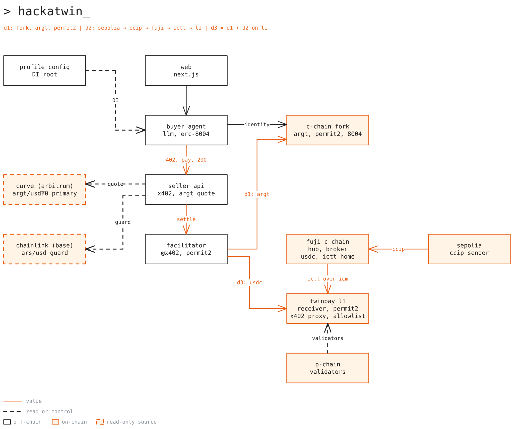

# hackatwin-x402-team1-avalanche

Agent payments on Avalanche, built for the Hackatwin talk "Pagos Autónomos en Avalanche L1: x402, Stablecoins y
Agentes de IA" by Twin and team1. In Demo 1 an AI agent with an ERC-8004 identity pays for an API response in real
ARGt over x402, on a local fork of the Avalanche C-Chain. In Demo 2 a payment travels through Chainlink CCIP to
`PaymentHub` on Fuji, then through Avalanche ICTT to `SettlementReceiver` on the TwinPay L1; the local run uses two
anvils and a CCIP simulator instead. A small web app runs Demo 1 from the browser and walks through the talk.



## What is where

| Folder | What it is |
|---|---|
| `apps/web` | Next.js talk site: landing page, guided talk path, and `/demo-1`, which runs Demo 1 from the browser |
| `demos/01-x402-twin` | Demo 1: buyer agent, seller API, x402 facilitator, and the fork scripts |
| `demos/02-l1-crosschain` | Demo 2: payment agent, lane setup script, and the hop tracker |
| `e2e/protocol` | The local Demo 2 world (two anvils, deploy, ICM relay) and the end-to-end suites |
| `packages/core` | Domain types, ports, and a small dependency injection container |
| `packages/config` | Config profiles and the only environment reader |
| `packages/chains` | Chain registry, addresses, keystores, and anvil helpers |
| `packages/contracts` | Foundry contracts: `PaymentHub`, `IcttMessenger`, `PaymentBroker`, `SettlementReceiver` |
| `packages/pricing` | The guarded USD to ARGt price oracle behind `pnpm quote` |
| `packages/agent-kit` | Agent building blocks: ERC-8004 identity, spending policy, x402 client, LLM, and runner |
| `packages/ui` | Design tokens and shared React atoms |
| `docs` | `demos.md` (full runbooks), `decisions.md` (decisions and verified addresses), and diagrams |
| `Avalanche_Workshops.html` | The workshop slides in Spanish: one HTML file, open it in a browser, works offline |
| `.claude`, `.mcp.json`, `AGENTS.md` | Agent tooling: skills and MCP servers used to build the repo |

Each package keeps its tests in its own `test/` folder.

## Setup

You need Node.js (version in `.nvmrc`), pnpm, and Foundry (`anvil`, `cast`, `forge`). Then:

```bash
pnpm install
```

## Demo 1: x402 + Twin

```bash
pnpm demo1:fork
pnpm demo1:fund
pnpm demo1:register
pnpm demo1:facilitator   # own terminal
pnpm demo1:seller        # own terminal
pnpm demo1 --scripted    # or `pnpm demo1` with ANTHROPIC_API_KEY set
```

Every script is idempotent. `pnpm demo1 --scripted` replaces only the LLM with a labeled scripted plan and needs no
secrets.

## Web page

After the fork, fund and register steps, start the facilitator, the seller API and the web app together, then open
`http://127.0.0.1:3000/demo-1` and press Run scripted:

```bash
pnpm web:demo1
```

`pnpm web` starts the web app alone when the services already run.

## Demo 2: local run

Development only: every line is labeled `SIMULATED (local-crosschain)`.

```bash
pnpm local:icm           # once: fetch and build the pinned icm-services into .cache/
pnpm demo2:local:up      # terminal 1: both anvils, the contracts, and the ICM relay
pnpm demo2:setup         # terminal 2: lane, approval, and budget
pnpm demo2 --scripted    # terminal 2: one payment, followed to Settled
```

The live testnet path and the details behind each step are in `docs/demos.md`.

## Tests

```bash
pnpm test                # unit tests with coverage
pnpm test:fork           # Demo 1 against a live C-Chain fork (needs anvil and an upstream RPC)
pnpm test:local          # Demo 2 local suite (run `pnpm local:icm` and `forge build` first)
pnpm typecheck
pnpm lint
cd packages/contracts && forge build && forge test
```

## Contributing

Issue, branch, commits, PR, merge, with Conventional Commits in English. See `CONTRIBUTING.md`.

## License

[MIT](LICENSE). The vendored Chainlink skills keep their own MIT notice.
