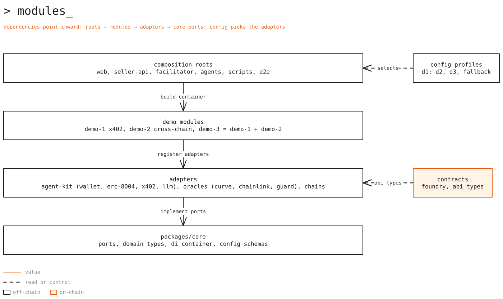
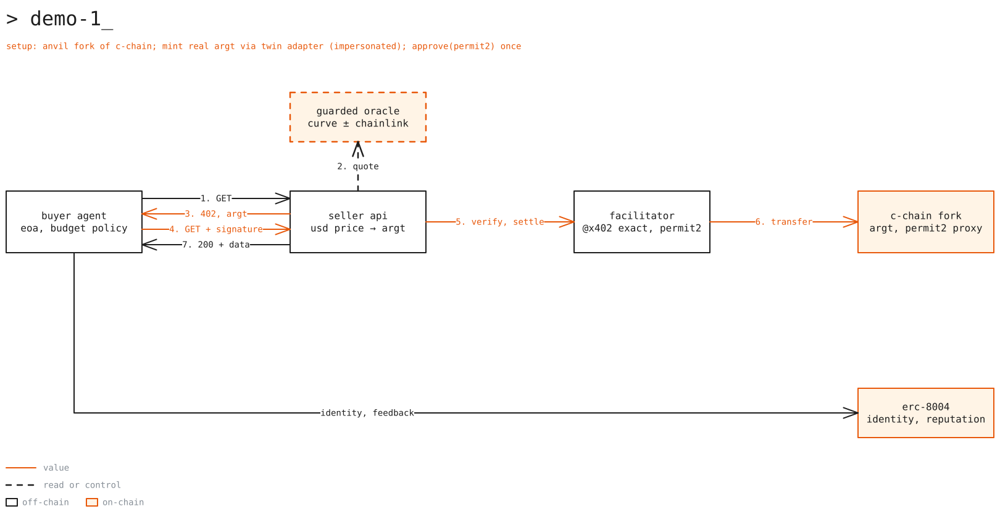
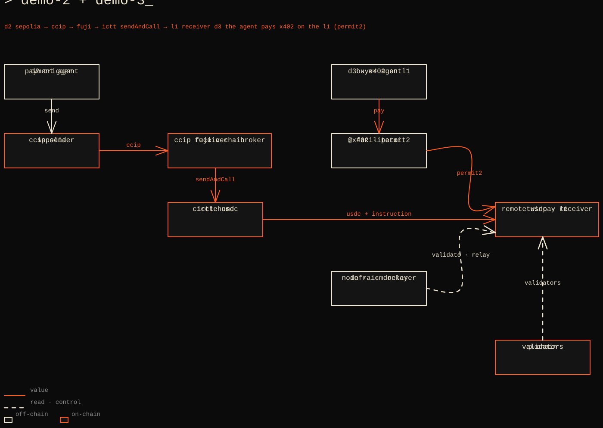
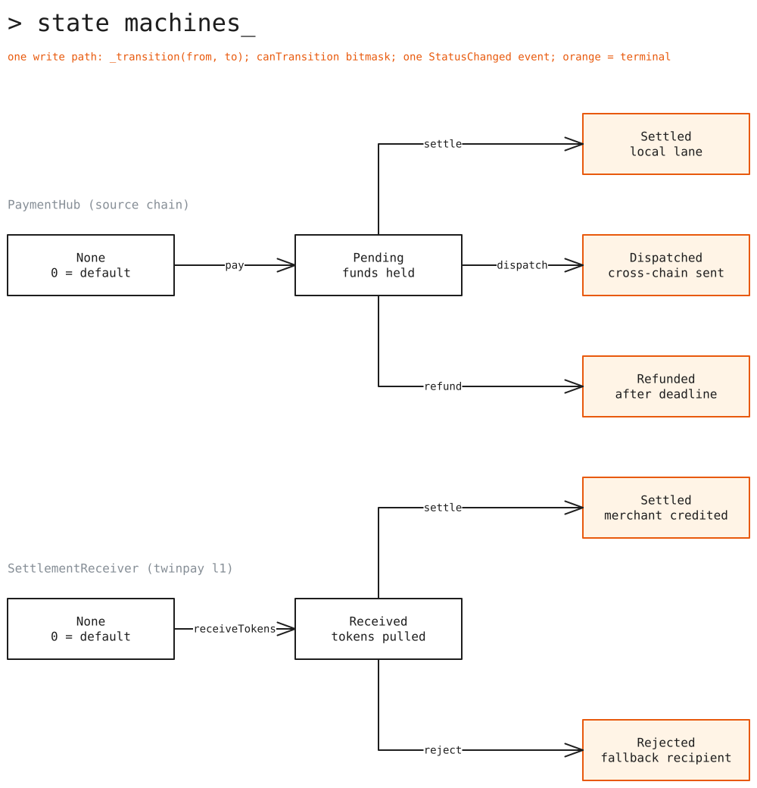

# hackatwin-x402-team1-avalanche

Agentic payment infrastructure on Avalanche. AI agents with an on-chain identity pay for APIs with x402 and
stablecoins, and settle cross-chain on a dedicated Avalanche L1.

Built for the Hackatwin talk **"Pagos Autónomos en Avalanche L1: x402, Stablecoins y Agentes de IA"**, co-presented
by Twin × team1. The repo itself is built by agents with MCP servers and skills, and the talk shows that workflow.

> **Status: design stage.** No application code yet. Implementation follows
> [`docs/plan-prompt.md`](docs/plan-prompt.md). Every decision and verified address lives in
> [`docs/decisions.md`](docs/decisions.md).

## The three demos

| Demo | What the audience sees | Runs on | Mode |
|---|---|---|---|
| 1 · x402 + Twin | An agent pays an API in real ARGt over HTTP 402 | Local anvil fork of Avalanche C-Chain mainnet | Live |
| 2 · TwinPay L1 | A payment travels Sepolia → Fuji → TwinPay L1 with CCIP and ICTT | Sepolia, Fuji, TwinPay L1 | Live + recorded fallback |
| 3 · Composed | The agent, funded via Demo 2, pays an API on the L1 with x402 | TwinPay L1 (Fuji) | Live + recorded fallback |

Runbooks: [`docs/demos.md`](docs/demos.md).

## Architecture overview


Edit: `docs/diagrams/overview.excalidraw`

The design is **hybrid** ([Q1](docs/decisions.md#decision-log)):

- **On-chain:** one immutable `PaymentHub` singleton per chain, built with Morpho Blue patterns (isolated lanes,
  owner-enabled plug-ins, EIP-712 authorization with an agent budget cap, callbacks), plus a `SettlementReceiver`
  on TwinPay L1. Demos 2 and 3 use them. Demo 1 has no custom contract.
- **Off-chain:** one TypeScript package per demo, hexagonal, wired by dependency injection from typed config
  profiles. Changing a profile changes chains, assets, and adapters with no code change.
- **Real contracts only:** real ARGt on a local mainnet fork, real testnet USDC, CCIP, and ICM. No mainnet
  transactions, no mocks.

## Modules and the dependency rule



Edit: `docs/diagrams/modules.excalidraw`

```text
composition roots  →  demo modules  →  adapters  →  packages/core (ports)
```

Dependencies point one way, toward `packages/core`:

1. **`packages/core`** holds domain types, port interfaces, config schemas, and a small typed DI container. It
   depends on nothing.
2. **Adapters** implement core ports (x402, viem, ERC-8004, CCIP, ICTT, Curve, Chainlink, Anthropic).
3. **Demo modules** register the adapters each demo needs, for example `registerX402Module(container, config)`.
4. **Composition roots**, one per runnable unit (seller API, agent, facilitator, scripts, E2E suites), load a
   validated config profile and build the container. Only composition roots read the environment or construct
   adapters.

### Ports

| Port | Responsibility | Adapters | Demos |
|---|---|---|---|
| `PaymentGateway` | Pay for, and accept, x402 payments | x402 client and self-hosted facilitator (`@x402/core`, `@x402/evm`); PayAI optional; x402-rs fallback | 1, 3 |
| `AgentIdentity` | Agent identity and reputation | ERC-8004 Identity and Reputation registries | 1, 2, 3 |
| `AgentPolicy` | Decide whether the agent may spend | Off-chain budget policy (Demo 1); on-chain cap through `PaymentHub` authorization (Demos 2, 3) | 1, 2, 3 |
| `ChainClient` | Read and write a chain | viem, configured from `packages/chains` | 1, 2, 3 |
| `LLM` | Reasoning and tool calls | Anthropic SDK, swappable through config | 1, 2, 3 |
| `PriceOracle` | Quote a USD price in ARGt | `GuardedOracle` wrapping `CurvePoolOracle` (Arbitrum) and `ChainlinkFeedOracle` (Base) | 1, 3 |
| `CrossChainMessenger` | Send and track a cross-chain payment | CCIP (Sepolia → Fuji), ICTT `sendAndCall` (Fuji → L1) | 2, 3 |

On-chain, the same idea appears as the `IMessenger` plug-in that `PaymentHub` calls to dispatch a payment
(`IcttMessenger`).

### Config profiles

| Profile (name to be fixed) | Chain | Asset | Transfer | Used by |
|---|---|---|---|---|
| C-Chain fork | Local fork, chain ID 43114 | Real ARGt | x402 `exact` + Permit2 | Demo 1 |
| Fuji cross-chain | Sepolia → Fuji → TwinPay L1 | Circle testnet USDC | CCIP + ICTT | Demo 2 |
| TwinPay L1 | TwinPay L1 | USDC bridged with ICTT | x402 `exact` + Permit2 | Demo 3 |
| Fuji C-Chain | Fuji C-Chain | Circle testnet USDC | x402 `exact` + ERC-3009 | Demo 3 fallback |

If Twin deploys official ARGt on Fuji, Demos 2 and 3 switch their asset to ARGt through config (Q17).

## Runtime flows

### Demo 1 · x402 + Twin



Edit: `docs/diagrams/demo-1.excalidraw`

1. The agent calls the seller API and gets `402 Payment Required`.
2. The quote is the API's USD price converted to ARGt by `GuardedOracle`: Curve's ARGt/USD₮0 pool, accepted when
   within ±2% of Chainlink ARS/USD, frozen for about 30 s.
3. The agent checks `AgentPolicy`, signs a Permit2 transfer (ARGt has no permit and no ERC-3009), and retries.
4. The self-hosted facilitator verifies and settles through the x402 Permit2 proxy. The API returns `200`.
5. The agent records feedback in the ERC-8004 Reputation Registry.

All of it happens on a local fork with the real ARGt contract. The agent's ARGt comes from the real `mint`, called
while impersonating Twin's LayerZero adapter.

### Demos 2 and 3 · TwinPay L1



Edit: `docs/diagrams/demo-2-3.excalidraw`

| Hop | From → to | Transport | State change |
|---|---|---|---|
| 1 | Agent on Sepolia → `PaymentBroker` on Fuji | CCIP, data-only | — |
| 2 | `PaymentBroker` → `PaymentHub` (Fuji) | Local call, within the treasury's EIP-712 budget | `None → Pending` |
| 3 | `PaymentHub` → `IcttMessenger` → TwinPay L1 | ICTT `sendAndCall`: USDC + instruction in one ICM message | `Pending → Dispatched` |
| 4 | ICM relayer → `SettlementReceiver` (L1) | `receiveTokens`, source and sender checked | `Received → Settled` or `Rejected` |

Demo 3 reuses hop 3 to fund the agent on the L1, then runs the Demo 1 flow there: x402 with Permit2 against
Permit2 and the x402 proxy deployed at their canonical addresses through the deterministic deployer in genesis.

## Contracts and state machines



Edit: `docs/diagrams/state-machines.excalidraw`

| Contract | States |
|---|---|
| `PaymentHub` (source) | `None → Pending → Settled` (local lane) · `Dispatched` (cross-chain) · `Refunded` (after deadline) |
| `SettlementReceiver` (L1) | `None → Received → Settled` · `Rejected` |

Every change goes through one `_transition` function, validated by a pure transition table, and emits one
`StatusChanged` event. Terminal states never change, and there are no acknowledgements back to the source, so a
payment cannot be spent twice. Full rules, interface sketch, and code standards:
[`docs/standards/smart-contracts.md`](docs/standards/smart-contracts.md).

## Agent tooling

| Tool | Where | Use it for |
|---|---|---|
| Avalanche MCP (read-only) | [`.mcp.json`](.mcp.json) | Docs search, CLI and RPC lookups, P-Chain state |
| OpenZeppelin MCP | [`.mcp.json`](.mcp.json) | OZ 5.7 contract scaffolding |
| ethskills plugin | [`.claude/settings.json`](.claude/settings.json) | Standards (x402, ERC-8004), security, testing |
| Chainlink CCIP skill | [`.claude/skills/chainlink-ccip-skill/`](.claude/skills/chainlink-ccip-skill/SKILL.md) | CCIP receiver patterns, local simulator tests |
| Chainlink Data Feeds skill | [`.claude/skills/chainlink-data-feeds-skill/`](.claude/skills/chainlink-data-feeds-skill/SKILL.md) | `ChainlinkFeedOracle` |
| Avalanche skill | [`.claude/skills/avalanche/`](.claude/skills/avalanche/SKILL.md) | L1s, ICM/ICTT, platform-cli, x402 on Avalanche |
| Devcontainer (planned) | `.devcontainer/` | Sandboxed agent sessions |

The devcontainer starts from Trail of Bits' `claude-code-devcontainer`, extended with Foundry, pnpm, Bulloak,
lintspec, and a firewall allowlist. It sets `bypassPermissions` inside the container and leaves outbound network
open unless the firewall is enabled. Non-Claude agents read the same pointers in [`AGENTS.md`](AGENTS.md).

## Repo layout

Target layout; `docs/PLAN.md` may refine it.

```text
hackatwin-x402-team1-avalanche/
├── apps/
│   ├── web/                    # one frontend: landing, guided talk path, /demo-1, /demo-2, /demo-3
│   └── docs/                   # Docusaurus site; content stays in docs/
├── demos/
│   ├── 01-x402-twin/           # seller API, buyer agent, facilitator, fork scripts; module.ts for Demo 3
│   ├── 02-l1-crosschain/       # L1 genesis + platform-cli scripts, payment agent; module.ts for Demo 3
│   └── 03-agentic-crosschain-commerce/  # config profiles + composition root only
├── packages/
│   ├── core/                   # domain types, ports, config schemas, DI container
│   ├── chains/                 # chain registry and addresses (fork, Fuji, Sepolia, L1, Arbitrum and Base read-only)
│   ├── contracts/              # Foundry: PaymentHub, IcttMessenger, PaymentBroker, SettlementReceiver; ABI types
│   ├── pricing/                # PriceOracle adapters (Curve, Chainlink, GuardedOracle); powers `pnpm quote`
│   ├── agent-kit/              # agent adapters: wallet, ERC-8004, x402 client, LLM
│   └── ui/                     # design tokens and components
├── infra/                      # docker-compose: L1 validator node + ICM relayer
├── e2e/                        # protocol E2E (Vitest + viem + anvil), UI E2E (Playwright), testnet smoke
├── docs/                       # Markdown docs and diagrams (source of the Docusaurus site)
├── .devcontainer/              # Trail of Bits devcontainer + Foundry/pnpm/bulloak/lintspec + firewall
├── .claude/                    # ethskills plugin, avalanche and Chainlink skills
├── .mcp.json                   # Avalanche MCP, OpenZeppelin MCP
├── AGENTS.md
└── CONTRIBUTING.md
```

## Docs

| Doc | Read it when |
|---|---|
| [Decisions](docs/decisions.md) | You need the why behind a choice, or a verified address |
| [Demos](docs/demos.md) | You run or rehearse a demo |
| [Smart contract standards](docs/standards/smart-contracts.md) | You write or review Solidity |
| [Alternative architecture](docs/architecture-alternative.md) | You question the hybrid design |
| [Planning prompt](docs/plan-prompt.md) | You start the implementation plan |
| [Twin Finance contracts](docs/references/twin-finance-contracts.md) | You need Twin token, pool, or oracle details |

## Conventions

Issue → branch → commits → PR → merge, gitflow with `feature/<name>`, Conventional Commits, English everywhere, and
no AI attribution. Details in [`CONTRIBUTING.md`](CONTRIBUTING.md). KISS · DRY · YAGNI.

## License

[MIT](LICENSE). The vendored Chainlink skills keep their own MIT notice.
