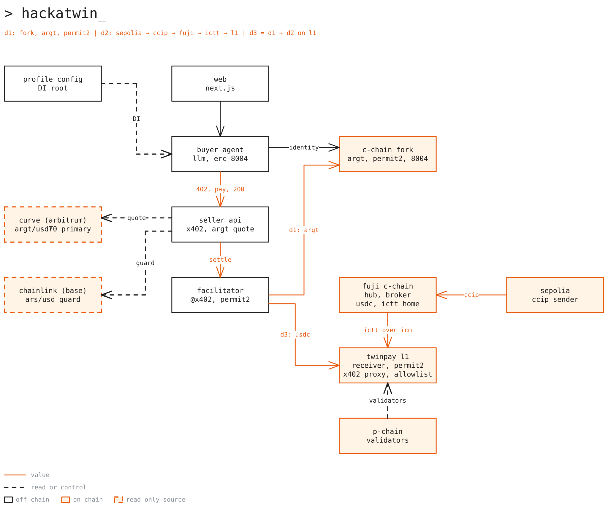
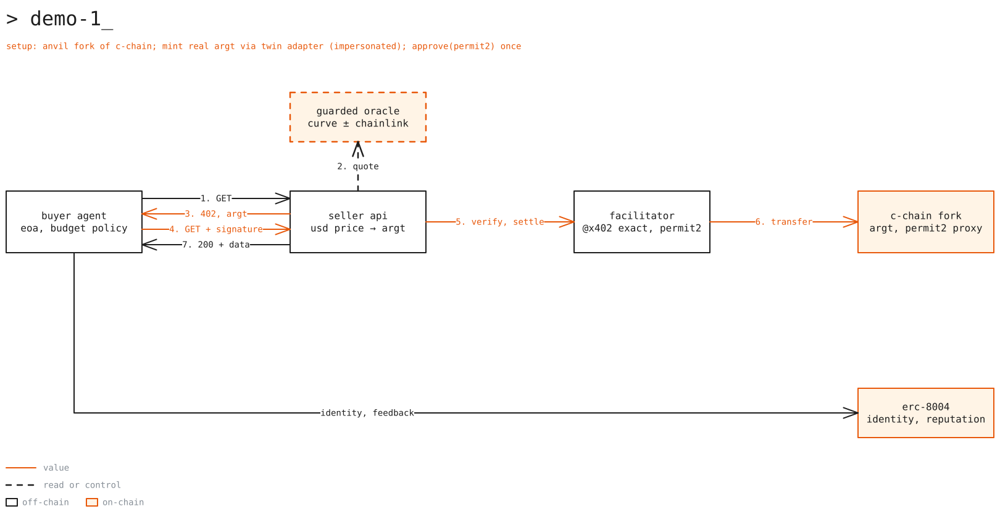
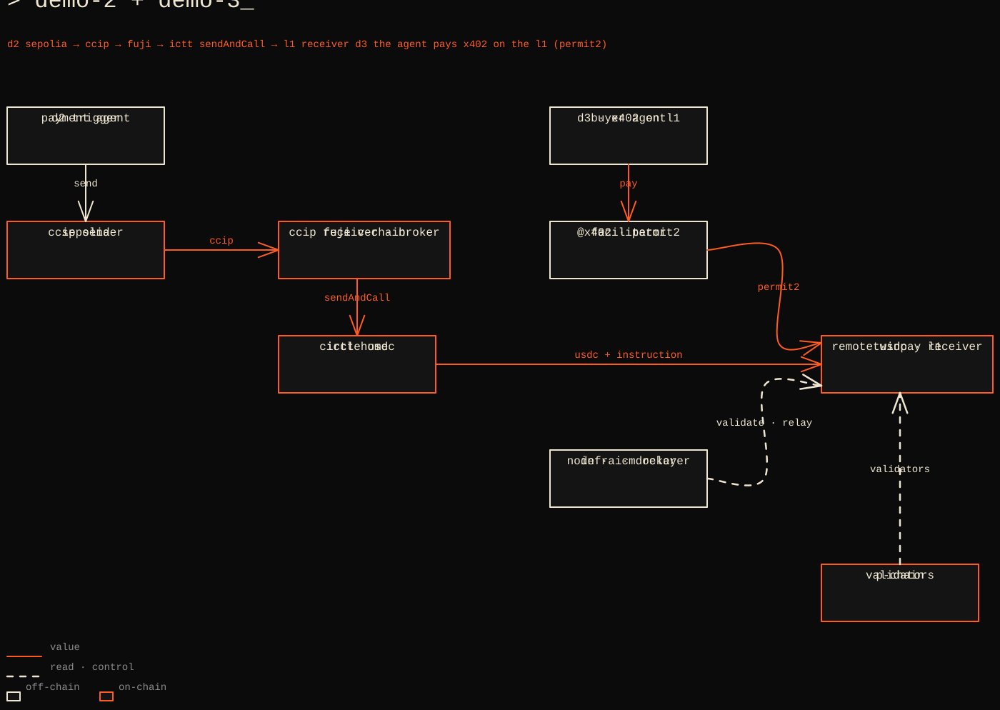
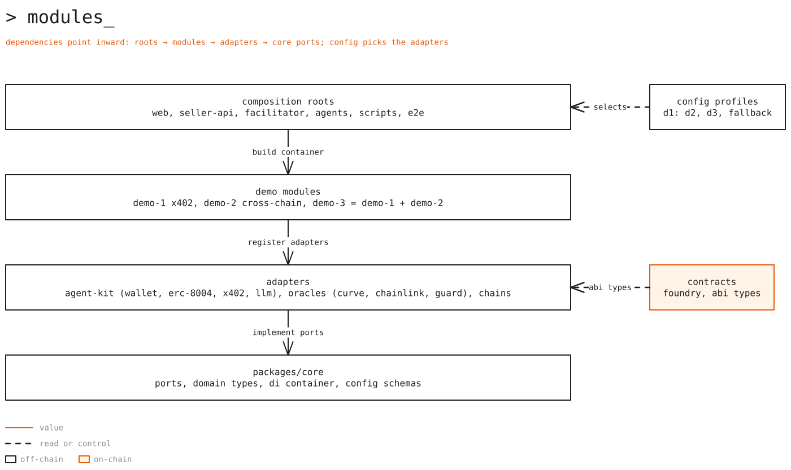
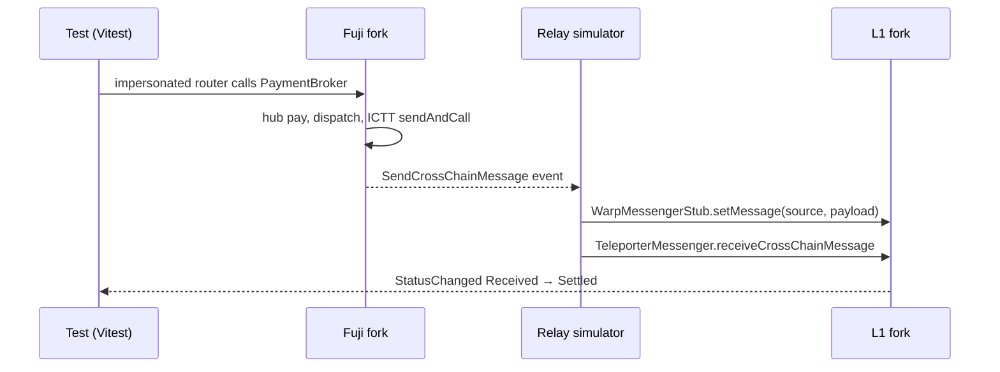

# Implementation plan

How we build the three talk demos, produced from the [planning prompt](plan-prompt.md). The plan works inside
[Decisions](decisions.md) and [Smart contract standards](standards/smart-contracts.md) and links to them instead of
repeating them. Runbooks stay in [Demos](demos.md).

| Section | Covers |
|---|---|
| [Step 0](#step-0-tooling-and-verification) | What loaded, what was verified, what drifted, what stays unverified |
| [1. Architecture](#1-architecture) | Overview, demo flows, dependency injection |
| [2. Repository structure](#2-repository-structure) | Final layout, one line per module |
| [3. Milestones](#3-milestones) | 13 milestones with acceptance criteria, demoable result, and tests |
| [4. Task breakdown](#4-task-breakdown) | 83 ready-to-file `Task` issues with branches and dependencies |
| [5. Decisions with tradeoffs](#5-decisions-with-tradeoffs) | DI container, ICTT in local E2E, hybrid check, open points, tooling |
| [6. Risks and mitigations](#6-risks-and-mitigations) | What can break and what we do about it |
| [7. Talk run-of-show](#7-talk-run-of-show) | Minute by minute, mapped to screens and fallbacks |
| [8. Open questions](#8-open-questions) | Decisions only the humans can make |

## Step 0: tooling and verification

Run on 2026-11-04. Re-check anything on-chain before a deploy or a rehearsal.

### What loaded

| Item | Result |
|---|---|
| Avalanche MCP and OpenZeppelin MCP (`.mcp.json`) | Not connected in this session. Replaced by Builder Hub docs (`llms.txt`, `llms-full.txt`, `.md` pages), `gh api` on public repos, the npm registry, the CCIP API, and read-only `cast call` against public RPCs. |
| ethskills plugin | Not loaded. Facts were checked at the primary source instead (contracts on-chain, source repos). |
| Local skills | `avalanche`, `chainlink-ccip-skill`, and `chainlink-data-feeds-skill` read, including the CCIP 2.0, Chainlink Local, and sequencer references. |
| Project docs | Decisions, standards, demos, alternative architecture, Twin reference, README, `CONTRIBUTING.md`, issue forms, PR template, and the text of every diagram. |
| Reference repos | `coinbase/x402`, `Uniswap/permit2`, `ava-labs/icm-services`, `ava-labs/platform-cli`, `erc-8004/erc-8004-contracts`, `smartcontractkit/ccip-icm`, `federiconardelli7/x402-starter-kit`, `defi-wonderland/solidity-foundry-boilerplate` (`dev`), `trailofbits/claude-code-devcontainer`, `x402-rs/x402-rs`. |

### Verified

| Fact | Result | How |
|---|---|---|
| npm packages | `@x402/core`, `@x402/evm`, `@x402/fetch`, `@x402/hono` 2.29.0; `@chainlink/contracts-ccip` 2.0.0; `@chainlink/local` 0.3.1; `@chainlink/contracts` 1.5.0; `@openzeppelin/contracts` 5.7.0 (npm tag `dev`, `latest` is 5.6.1); `@anthropic-ai/sdk` 1.4.0; `@chainlink/ccip-sdk` 1.16.1 | npm registry |
| `@chainlink/local` 0.3.1 | Depends on `@chainlink/contracts-ccip` 2.0.0, OZ 4.8.3 and 5.3.0 aliases, `forge-std` `v1.9.4`; peer dependencies on Hardhat 3 and ethers | npm registry |
| x402 EVM constants | The Permit2 and exact Permit2 proxy addresses in decisions are the constants in `@x402/evm` | `coinbase/x402` `main` |
| x402 facilitator | `registerExactEvmScheme({ signer, networks })` accepts any `eip155:<id>`; Permit2 verify rejects a `deadline` under now + 6 s; simulation runs during verify | same |
| x402 server | `registerMoneyParser` turns a USD price into an explicit `AssetAmount`; Permit2 assets without EIP-2612 omit `name` and `version`; no default asset for `eip155:43113`; a 402 lists several `accepts` entries; requirements carry `maxTimeoutSeconds` (there is no `validUntil` field) | same |
| x402 client | `createPermit2ApprovalTx` and `getPermit2AllowanceReadParams` cover the one-time `approve(Permit2)`; v2 headers are `PAYMENT-REQUIRED`, `PAYMENT-SIGNATURE`, `PAYMENT-RESPONSE` | same |
| x402 proxy deploy | `contracts/evm/script/Deploy.s.sol` deploys a pre-built init code (`script/data/exact-proxy-initcode.hex`) through the Arachnid deployer with a fixed salt, and requires Permit2 on the chain. License Apache-2.0. | same |
| Permit2 | Salt matches decisions; built with solc 0.8.17, `via_ir`, 1,000,000 optimizer runs, `bytecode_hash = "none"`. License MIT. | `Uniswap/permit2` |
| ARGt on C-Chain | Symbol ARGt, 18 decimals; Twin's adapter holds `MINTER_BURNER_ROLE` (`keccak256("MINTER_BURNER_ROLE")`); `mint` from the adapter succeeds in `eth_call` and reverts for any other caller; `nonces()` reverts (no permit) | `cast call`, public RPC |
| Code at addresses | C-Chain: Permit2, x402 proxy, ERC-8004 registries, Arachnid deployer, Teleporter. Fuji: the same plus Circle USDC, CCIP router, LINK, and TeleporterRegistry `0xF86Cb19Ad8405AEFa7d09C778215D2Cb6eBfB228`. | `cast codesize` |
| Fuji USDC | EIP-712 domain `USD Coin`, version `2`, 6 decimals, `authorizationState` present (ERC-3009) | `cast call` |
| C-Chain RPCs | Primary serves state 5,000,000 blocks back. Backup (`publicnode`) serves 100,000 blocks back and times out at 5,000,000. | `cast call --block` |
| Pricing sources | Curve pool `coins(0)` is ARGt and `coins(1)` USD₮0, `price_oracle()` ≈ 1658.35, about 24.5M ARGt and 14.8k USD₮0. Chainlink ARS/USD: 8 decimals, inside its heartbeat. Base sequencer uptime feed `0xBCF85224fc0756B9Fa45aA7892530B47e10b6433`, status up. | `cast call`, Chainlink docs |
| CCIP lane | Sepolia → Fuji exists, version 2.0.0, routers match decisions, median latency about 16.5 min | CCIP API (`/v2/lanes`, `/v2/lanes/latency`, `/v2/chains`) |
| CCIP extraArgs | `bytes4(0)` equals `FinalityCodec.WAIT_FOR_FINALITY_FLAG` (full finality) | `chainlink-ccip-skill` |
| ICM | Teleporter has one address on all chains and the docs give a genesis `alloc` for new L1s; `IERC20SendAndCallReceiver` and `SendAndCallInput` match decisions; `ERC20TokenRemote` sends the unused allowance to `fallbackRecipient` after `receiveTokens` (all of it when the call fails); Warp precompile at `0x0200000000000000000000000000000000000005` | `ava-labs/icm-services`, Builder Hub docs |
| ICM license | Ava Labs Ecosystem License 1.1 (`LicenseRef-Ecosystem`): use only with Avalanche Mainnet, Fuji, and linked L1s, or for non-production testing; not with forks of the platform; ship the license unmodified; no Ava Labs names or logos without consent | `LICENSE` in `icm-services` |
| ERC-8004 | Addresses match decisions; `register(string)`; `giveFeedback(uint256 agentId, int128 value, uint8 valueDecimals, string tag1, string tag2, string endpoint, string feedbackURI, bytes32 feedbackHash)`; feedback from the agent's owner or operators reverts | `erc-8004/erc-8004-contracts` |
| Avalanche releases | AvalancheGo v1.15.2 (Helicon.2) recommended on Mainnet and Fuji, plugin version 47; Helicon (ACP-194 continuous execution) active on Mainnet since 2026-09-22; images `avaplatform/subnet-evm:v1.15.2` and `avaplatform/icm-relayer:v1.8.3` exist | Builder Hub releases page, GitHub, Docker Hub |
| EVM and genesis | C-Chain and Subnet-EVM run Cancun (no Pectra); `warpConfig.requirePrimaryNetworkSigners` documented; genesis `initialMinDelayMS` since v1.15.0; TxAllowList precompile at `0x0200000000000000000000000000000000000002`; Builder Hub explorer and verifier cover catalog L1s that have a public RPC | `llms-full.txt` |
| platform-cli | v2.3.0: `subnet create`, `chain create --subnet-id --genesis --name`, `subnet convert-to-l1`, `l1 register-validator`, `l1 increase-validator-balance` | `ava-labs/platform-cli` `docs/usage.md` |
| Wonderland `dev` | Commit `504ada8`: `solc_version = '0.8.30'` with `evm_version = 'prague'` (we override), `forge-std` from GitHub `v1.9.2`, layout `src/contracts`, `src/interfaces`, `test/unit/*.tree`, plus a `deploy:mainnet` script (we drop it) | repo |
| Devcontainer | The firewall is a README `ipset`/`iptables` recipe, not a toggle; rules are lost on restart; IPv6 is not filtered. License Apache-2.0. | repo README |
| Reference repos | `x402-starter-kit` has no license (reuse the flow, copy no code) and uses thirdweb with the v1 `X-PAYMENT` header. `ccip-icm` is MIT and tests ICM with forks plus `vm.mockCall` on the Warp precompile. | GitHub API |
| Facilitator alternatives | PayAI `/supported` lists `eip155:43113` and `eip155:43114`; it is public, so only the Fuji profile can use it. x402-rs 2.0.0 supports Permit2 but requires `name` and `version` in Permit2 payloads. | `facilitator.payai.network`, x402-rs changelog |
| Anthropic | `claude-sonnet-5-5` is a current model ID; it rejects forced `tool_choice` (`any`, `tool`) and `thinking: disabled` | Claude API reference |
| Links | Builder Hub faucet, Circle faucet, Chainlink faucet, CCIP Explorer, Fuji P-Chain explorer, and the team1 logo SVG respond | `curl` |

### Drift since decisions.md

| Item | decisions.md says | Now | Plan |
|---|---|---|---|
| CCIP Sepolia → Fuji | Active | CCIP API status `MAINTENANCE`; last successful messages on 2026-11-02 | Check in `pnpm preflight` (T12.2); trigger Demo 2 early ([§ 7](#7-talk-run-of-show)) |
| Validator image | Console pins v1.15.0-fuji, docs list v1.15.2 | v1.15.2 is recommended and moves plugins to version 47 | Pin `v1.15.2` (T6.3) |
| C-Chain execution | Not covered | Helicon made execution asynchronous; historical reads still work | Pick `N` from executed blocks, behind the head (T5.1) |
| Open point: refund on the L1 | Open | Closed by [standards § 2](standards/smart-contracts.md#2-state-pattern) and the verified ICTT allowance sweep | Close it (T1.7) |
| Open point: ICM license | To verify | Ecosystem License 1.1 | Human sign-off (O7) |
| Open point: backup RPC | Unverified | Serves recent state only | Fallback for a recent `N` only |
| x402-rs fallback | To verify | Permit2 payload format differs from `@x402/evm` | Interop check (T11.3) |

### Still unverified

- That the published `@x402/evm@2.29.0` tarball matches the `main` source read above (check in `node_modules` in T5.3).
- TwinPay L1 chain ID availability and how an L1 joins the Builder Hub chain catalog.
- The Builder Hub explorer path for Fuji (Snowtrace testnet stays the default).
- The L1 validator's continuous fee per month and its minimum balance.
- Faucet daily limits and login requirements.
- The Builder Hub ICTT console flow (not exercised).
- Rebuilding Permit2's canonical init code (the deploy script asserts the address before broadcasting).
- The x402-rs Docker tag and its Permit2 interop with `@x402/evm`; PayAI Permit2 support.
- Brand and logo usage rights.
- Avalanche MCP tools (`cli_lookup_command`, `platform_get_*`), not exercised.

## 1. Architecture

### 1.1 Overview



The design is the hybrid in [Q1](decisions.md#decision-log): an on-chain `PaymentHub` core on Fuji with a
`SettlementReceiver` on TwinPay L1, and one hexagonal package per demo off-chain, wired by dependency injection from
typed profiles. The plan rests on four rules:

1. Dependencies point toward `packages/core` (roots → modules → adapters → ports).
2. Only composition roots read the environment or construct adapters.
3. Every address comes from `packages/chains`, for TypeScript and Foundry scripts alike.
4. Agents report progress as one typed `AgentEvent` stream. The CLI, the web app, the recordings, and the E2E
   assertions all consume it, so live runs and replays share one schema.

Fix in T3.5: the overview labels the L1 box "hub, permit2, acl". Per the standards the hub lives on Fuji; the L1 runs
`SettlementReceiver`, Permit2, the x402 proxy, and the allowlist.

### 1.2 Demo flows

**Demo 1.** Flow and steps: [Demos › Demo 1](demos.md#demo-1-x402--twin).



The plan adds four things:

- The seller API gets its own ERC-8004 identity. The registry rejects self-feedback, so the buyer rates the
  seller's `agentId`.
- A fork guard: the `cchain-fork` profile starts only against a local anvil. The fork keeps chain ID 43114 (Q20), so
  every key on it is fresh, not only the agent's.
- The quote freeze (Q12) maps to x402 `maxTimeoutSeconds: 30` plus the Permit2 `deadline`.
- anvil runs with `--hardfork cancun` to match the C-Chain EVM.

**Demos 2 and 3.** Flow and steps: [Demos › Demo 2](demos.md#demo-2-twinpay-l1) and
[Demo 3](demos.md#demo-3-composed). State machines: [standards § 2](standards/smart-contracts.md#2-state-pattern).



The plan adds five things:

- Genesis additions that Q15's goals need: TeleporterMessenger predeployed (ICM needs it on the L1), TxAllowList roles
  for the relayer, facilitator, deployer, and agents (otherwise the relayer cannot deliver and the facilitator cannot
  settle), and the validator manager the L1 conversion requires.
- The L1 token is the ICTT `ERC20TokenRemote` itself. It has no permit and no ERC-3009, so Permit2 is the only x402
  method on the L1, as Q13 assumes.
- On `Rejected`, ICTT sends the unused allowance to `fallbackRecipient` on the L1, so a rejected payment lands on an L1
  address, not on Fuji.
- CCIP takes about 16.5 minutes on this lane, so the run-of-show triggers Demo 2 at the start of the talk.
- Demo 3 funds the agent with a direct ICTT `send` (seconds), so it never waits on CCIP.

### 1.3 Dependency injection



Each runnable unit has one composition root. T3.5 adds this table to `docs/diagrams/modules.excalidraw`.

| Composition root | Profiles | Ports it wires | Adapters |
|---|---|---|---|
| `demos/01-x402-twin/seller-api` | `cchain-fork`, `twinpay-l1`, `fuji-cchain` | `PriceOracle`, `PaymentGateway` (seller), `AgentIdentity`, `ChainClient` | `GuardedOracle` over Curve and Chainlink, `@x402/hono` resource server, ERC-8004, viem |
| `demos/01-x402-twin/facilitator` | same | `PaymentGateway` (facilitator), `ChainClient` | `x402Facilitator` with the exact EVM scheme, viem wallet from a keystore |
| `demos/01-x402-twin/buyer-agent` | `cchain-fork` | `LLM`, `PaymentGateway` (client), `AgentPolicy`, `AgentIdentity`, `ChainClient` | Anthropic SDK, `@x402/fetch`, off-chain budget, ERC-8004, viem |
| `demos/02-l1-crosschain/payment-agent` | `fuji-crosschain` | `LLM`, `CrossChainMessenger`, `AgentPolicy`, `AgentIdentity`, `ChainClient` | Anthropic SDK, CCIP sender, hop tracker, `PaymentHub` authorization, ERC-8004 on Fuji, viem |
| `demos/03-agentic-crosschain-commerce/main.ts` | `twinpay-l1`, `fuji-cchain` | Everything above, through the two modules | `registerX402Module` and `registerCrossChainModule` only |
| `apps/web` server | Per screen | Same modules, plus a replay source | Same adapters; client ports (wallet) through React context |
| Scripts (`pnpm quote`, fork funding, setup) | Each | `PriceOracle`, `ChainClient`, `AgentIdentity` | Same adapters |
| `e2e/*` test roots | Test profiles | Same ports | Scripted LLM fake, anvil forks, ICM relay simulator |

Demo 3 owns no domain logic; its config is the demo moment (validated with zod, invalid pairs rejected):

```ts
export const demo3 = defineDemo3Config({
  network: 'twinpay-l1',
  asset: 'USDC',
  transferMethod: 'permit2',
  facilitator: 'x402-ts',
  llm: 'claude',
});
```

Only implemented values enter the enums. `payai`, `x402-rs`, and `openrouter` join when an adapter exists (YAGNI).

## 2. Repository structure

```text
hackatwin-x402-team1-avalanche/
├── docs/                          # Markdown source of the docs site, diagrams, this plan
├── apps/
│   ├── web/                       # Next.js: landing, guided path, /demo-1, /demo-2, /demo-3; server composition root
│   │   └── recordings/            # JSONL AgentEvent recordings of real testnet runs (replay fallback)
│   └── docs/                      # Docusaurus site; docs.path → ../../docs
├── demos/
│   ├── 01-x402-twin/
│   │   ├── seller-api/            # x402-protected ARS FX quote API (root)
│   │   ├── facilitator/           # self-hosted x402 facilitator (root)
│   │   ├── buyer-agent/           # buyer agent (root)
│   │   ├── adapters/              # seller-side PaymentGateway and facilitator adapters
│   │   ├── scripts/               # fork start, funding via impersonated mint, identity registration
│   │   └── module.ts              # registerX402Module(container, config)
│   ├── 02-l1-crosschain/
│   │   ├── l1/                    # genesis and platform-cli runbook scripts
│   │   ├── adapters/              # CrossChainMessenger: CCIP sender, hop tracker, ICTT funding
│   │   ├── payment-agent/         # cross-chain payment agent (root)
│   │   ├── scripts/               # lane and treasury authorization setup
│   │   └── module.ts              # registerCrossChainModule(container, config)
│   └── 03-agentic-crosschain-commerce/
│       ├── demo3.config.ts        # typed profile selection
│       └── main.ts                # composition root only
├── packages/
│   ├── core/                      # DI container, domain types, ports; testing/ holds fakes; no dependencies
│   ├── config/                    # zod profile schemas and loadProfile, the only process.env reader (ADR 0005)
│   ├── chains/                    # registry JSON for TS and Foundry, viem ChainClient, fork guard, chains:verify
│   ├── contracts/                 # Foundry: the four contracts, L1 Permit2 and x402 proxy deploys, ABI exports
│   ├── pricing/                   # CurvePoolOracle, ChainlinkFeedOracle, GuardedOracle; pnpm quote
│   ├── agent-kit/                 # agent runner, Claude LLM, x402 client, ERC-8004, wallet, off-chain policy
│   └── ui/                        # design tokens and atoms for web and the docs theme
├── infra/                         # docker-compose: validator, ICM relayer, restricted RPC proxy; l1:health
├── e2e/
│   ├── protocol/                  # Vitest + viem on anvil forks; ICM relay simulator and Warp stub
│   ├── ui/                        # Playwright with a test wallet
│   └── smoke/                     # real Fuji, Sepolia, and L1, manual or nightly
├── .devcontainer/                 # Trail of Bits base, project tools, egress allowlist
├── .github/                       # CI, rulesets, issue forms, PR template, CODEOWNERS
├── .claude/                       # ethskills plugin, Avalanche and Chainlink skills
├── .mcp.json                      # Avalanche MCP, OpenZeppelin MCP
├── AGENTS.md                      # tooling pointers for non-Claude agents
├── CONTRIBUTING.md                # gitflow and commit conventions
└── .env.example                   # every variable, no values
```

Changes from the proposed structure:

1. `packages/chains` is JSON first, so Foundry scripts and TypeScript read the same file
   ([standards § 3](standards/smart-contracts.md#3-code-standards) requires scripts to use the shared registry). It
   also holds the viem `ChainClient` adapter and the fork guard.
2. Seller and facilitator adapters live in `demos/01-x402-twin/adapters/`: only Demo 1 needs them, and Demo 3 gets
   them through `registerX402Module`. Buyer adapters stay in `agent-kit` because the Demo 2 and 3 agents reuse them.
3. The agent loop (`createAgent`) lives in `agent-kit`, so Demo 2 reuses Demo 1's agent core without importing Demo 1.
4. `CrossChainMessenger` adapters live in `demos/02-l1-crosschain/adapters/`, their only owner.
5. `apps/web/recordings/` keeps the replay fallback in the same `AgentEvent` schema as live runs.
6. `infra/` adds a restricted proxy for the public L1 RPC that explorers and the web app need.
7. `e2e/protocol` holds the test-only ICM relay simulator and Warp stub ([§ 5.3](#53-ictt-paths-in-local-e2e)).
8. `packages/ui` stays a package because it has two consumers: the web app and the docs theme.

## 3. Milestones

| # | Milestone | Demoable result | Starts after |
|---|---|---|---|
| M1 | Repo setup | CI gates every PR; the docs site builds from `docs/` | PRs #3, #5, #7 and this plan merged |
| M2 | Devcontainer | An agent session runs in the container behind the egress allowlist | M1 |
| M3 | Scaffold + `packages/core` DI | A test swaps a real adapter for a fake through the container | M1 |
| M4 | Shared packages | `pnpm quote` prints the live ARGt rate | M3 |
| M5 | Demo 1 | The agent pays the API in real ARGt on the fork | M4 |
| M6 | Infra + TwinPay L1 | The L1 produces blocks; 1 USDC bridged Fuji → L1 | M4 (in parallel with M5) |
| M7 | Contracts | Contracts on Fuji and the L1; Permit2 and the x402 proxy at canonical addresses on the L1 | M3, M6 |
| M8 | Demo 2 | One payment tracked Sepolia → Fuji → L1 | M5, M7 |
| M9 | Demo 3 | The same agent pays on the L1, then on Fuji after a profile switch | M8 |
| M10 | Frontend | The guided talk path with live demo screens | M9 (T10.1 to T10.4 can start after M3) |
| M11 | E2E hardening | Nightly suites green; failure paths covered | M10 |
| M12 | Rehearsal with recorded fallbacks | Two dress rehearsals within the slot | M11 |
| M13 | `release/1.0.0` | Tag `v1.0.0`; production web and docs | M12 |

### M1: Repo setup

- **Acceptance criteria:** PR CI checks title, commits, branch name, workflows, and the workspaces touched (path
  filters); a local commit-msg hook rejects non-conventional messages; Docusaurus builds from `docs/` with no broken
  links; rulesets protect `main` and `develop`; docs deploy from `main` to GitHub Pages; decisions.md records the
  Step 0 drift.
- **Demoable result:** a PR with a bad title fails, a good one passes, and the docs site shows this plan.
- **Tests:** CI jobs `pr-title`, `commits`, `branch-name`, `lint`, and `docs-build` (`onBrokenLinks: 'throw'`).

### M2: Devcontainer

- **Acceptance criteria:** the container builds from a pinned upstream commit; Foundry, pnpm, bulloak, and lintspec
  work; the egress allowlist applies on every start, for IPv4 and IPv6.
- **Demoable result:** inside the container Claude Code works and a request to a non-listed host times out.
- **Tests:** a path-filtered CI job builds the image and checks tool versions; a firewall check script (manual, needs
  `NET_ADMIN`).

### M3: Scaffold + `packages/core` DI

- **Acceptance criteria:** every workspace in [§ 2](#2-repository-structure) exists and builds; `packages/core` has no
  runtime dependencies; ports, domain types, config schemas, and the container ship with fakes; only composition roots
  read `process.env`.
- **Demoable result:** a unit test resolves a service with a real adapter, then swaps in a fake through `child()`.
- **Tests:** Vitest on the container (scopes, cycles, disposal, overrides) and on the config schemas; a dependency-rule
  test.

### M4: Shared packages

- **Acceptance criteria:** the registry holds only verified addresses with sources; `pnpm chains:verify` passes;
  `GuardedOracle` uses Curve within ±2% of Chainlink and Chainlink otherwise, flagged; `pnpm quote` prints the
  [Demos](demos.md#demo-1-x402--twin) format.
- **Demoable result:** `1 USD = 1658.3 ARGt (Curve, block N) | Chainlink 1657.9 | Δ 0.02% ✓`.
- **Tests:** unit tests with a fake `ChainClient` (band edges, stale round, sequencer down); nightly integration tests
  against Arbitrum and Base.

### M5: Demo 1

- **Acceptance criteria:** the agent, with an ERC-8004 identity on the fork, gets a `402`, checks its budget, signs
  Permit2, gets a `200`, and rates the seller; the self-hosted facilitator settles through the canonical proxy; no
  custom contract; the fork guard holds.
- **Demoable result:** `pnpm demo1` prints 402 → policy → signature → 200 → feedback, with ARGt balances before and
  after.
- **Tests:** protocol E2E on the pinned fork with a scripted LLM (DI swap); unit tests for policy, x402 client, and
  identity; a facilitator integration test on the fork.

### M6: Infra + TwinPay L1

- **Acceptance criteria:** TwinPay L1 is converted with our validator on the VM; the relayer delivers Fuji → L1
  Teleporter messages; the ICTT bridge for Circle USDC works; the RPC is exposed only through the proxy; the health
  check covers the validator balance.
- **Demoable result:** send 1 USDC Fuji → L1 and show the L1 balance.
- **Tests:** a genesis validation test; `pnpm l1:health`; a bridge smoke test on testnets.

### M7: Contracts

- **Acceptance criteria:** the contracts are built test-first per [Q21](decisions.md#decision-log) and meet the
  standards (interface first, custom errors, NatSpec, Bulloak trees, invariants); deploy scripts read the registry; security checklists ran; addresses are recorded; Permit2 and the x402
  proxy sit at canonical addresses on the L1.
- **Demoable result:** `cast code` returns code at both canonical addresses on the L1, and the explorer shows the
  verified hub on Fuji.
- **Tests:** `forge test` (unit, integration with `CCIPLocalSimulator`, fuzz, invariants), `forge fmt --check`,
  lintspec, and Bulloak checks in CI; deep fuzz nightly.

### M8: Demo 2

- **Acceptance criteria:** the payment agent sends a data-only CCIP message; the broker accepts only the allowlisted
  pair; the hub records `None → Pending → Dispatched`; the receiver records `Received → Settled`; one event per hop;
  the tracker follows the payment end to end.
- **Demoable result:** the CLI tracker prints CCIP → Fuji → L1 with explorer links.
- **Tests:** cross-chain protocol E2E with the local relay; testnet smoke (manual or nightly).

### M9: Demo 3

- **Acceptance criteria:** `demo3.config.ts` selects modules and adapters; `main.ts` holds no domain logic; the agent
  pays x402 on the L1 with Permit2 and updates ERC-8004 reputation on Fuji; switching to `fuji-cchain` changes chain,
  asset, and transfer method with no code change.
- **Demoable result:** run on `twinpay-l1`, switch the profile, run on `fuji-cchain`.
- **Tests:** config-matrix E2E (one case per profile); a dependency test on the root.

### M10: Frontend

- **Acceptance criteria:** one app in the talk's narrative order; live wallet, reasoning and tool calls, 402 → pay →
  200, tx hashes (explorer links on public networks), and cross-chain status; `/demo-3` switches profiles live; replays
  for Demos 2 and 3 are labeled; container/presentational split and atomic design.
- **Demoable result:** the presenter clicks through the whole path on a laptop.
- **Tests:** Playwright UI E2E with a test wallet; unit tests for presentational components.

### M11: E2E hardening

- **Acceptance criteria:** nightly suites green three nights in a row; failure paths covered; fork E2E stable with a
  warm RPC cache; runbooks hold real commands; the x402-rs fallback scope is known.
- **Demoable result:** the nightly run summary.
- **Tests:** failure-path E2E; 20 reruns with no flakes.

### M12: Rehearsal with recorded fallbacks

- **Acceptance criteria:** recordings of real testnet runs exist; `pnpm preflight` is green; two full dress rehearsals
  fit the slot; each failure is filed as a `Bug` issue and fixed or accepted.
- **Demoable result:** a full talk run that exercises one fallback per networked demo.
- **Tests:** `pnpm preflight`; the rehearsal log.

### M13: `release/1.0.0`

- **Acceptance criteria:** `release/1.0.0` merges into `main` and back into `develop`; tag `v1.0.0`; a GitHub Release
  with a changelog generated from commits; production web and docs deployed from the tag.
- **Demoable result:** the release page and the production site.
- **Tests:** all PR checks green on the release PR; the release workflow run.

## 4. Task breakdown

How to file: each block maps onto the `Task` form (title, What, Done when). `Tn.m` IDs are for dependencies only;
replace them with issue numbers once filed. Branches start from `develop`, commits use the title's scope and
`Refs #<issue>`, and each PR closes one issue, as `CONTRIBUTING.md` requires.

Before M1, merge the open PRs into `develop` in order: #3 (bootstrap), #5 (CI pipeline), #7 (design docs), then this
plan. `develop` still points at the initial commit, so the CI and conventions the prompt describes only take effect
after these merges.

### M1 tasks: Repo setup

**T1.1 `chore(repo): add pnpm workspace and typescript base`**

- Branch: `feature/pnpm-workspace`
- Depends on: none
- What: Root pnpm workspace with pinned pnpm and Node, a pnpm catalog for exact shared versions, a strict TypeScript
  base, and Biome for format and lint.
- Done when:
  - [ ] `pnpm install --frozen-lockfile` passes on a clean clone
  - [ ] `pnpm lint`, `pnpm typecheck`, and `pnpm test` run from the root
  - [ ] `tsconfig.base.json` sets `strict: true` and `.env.example` exists

**T1.2 `ci: add commit-msg hook with commitlint`**

- Branch: `feature/commit-hooks`
- Depends on: T1.1
- What: A husky commit-msg hook that runs the existing `commitlint.config.mjs` locally, so bad messages fail before CI.
- Done when:
  - [ ] `pnpm install` installs the hook
  - [ ] A non-conventional message is rejected locally
  - [ ] The CI `commits` job stays green

**T1.3 `docs: scaffold docusaurus site at apps/docs`**

- Branch: `feature/docusaurus-site`
- Depends on: T1.1
- What: Docusaurus classic preset reading `docs.path: '../../docs'`, with sidebars from frontmatter and the Mermaid
  theme for the existing diagrams.
- Done when:
  - [ ] `pnpm --filter docs build` passes with `onBrokenLinks: 'throw'`
  - [ ] Excalidraw SVGs and Mermaid blocks render
  - [ ] No file is copied out of `docs/`

**T1.4 `ci: add workspace jobs with path filters`**

- Branch: `feature/ci-workspace-jobs`
- Depends on: T1.1, T1.3
- What: Extend `ci.yml` with a changes job and per-workspace lint, typecheck, test, and build jobs, using the pnpm
  cache and a frozen lockfile.
- Done when:
  - [ ] Each job runs only when its paths change; Demo 3 jobs also run on Demo 1, Demo 2, or `packages/` changes
  - [ ] Every job has `timeout-minutes` and least-privilege `permissions`
  - [ ] Actions are pinned to commit SHAs and actionlint passes

**T1.5 `ci: add codeowners and branch rulesets`**

- Branch: `feature/branch-rulesets`
- Depends on: T1.4
- What: `CODEOWNERS` plus rulesets for `main` and `develop` kept as JSON in `.github/rulesets/` and applied with
  `gh api`.
- Done when:
  - [ ] PRs require green checks; force pushes and deletions are blocked
  - [ ] A direct push to `develop` is rejected
  - [ ] The apply command is documented in `CONTRIBUTING.md`

**T1.6 `ci: deploy docs to github pages`**

- Branch: `feature/docs-deploy`
- Depends on: T1.3, T1.4
- What: Deploy the docs site from `main` to GitHub Pages with OIDC; PRs upload the built site as an artifact until a
  preview host is chosen (O9).
- Done when:
  - [ ] A merge to `main` publishes the site
  - [ ] Re-running the deploy is idempotent
  - [ ] PRs attach the built site

**T1.7 `docs: record step 0 drift in decisions`**

- Branch: `feature/decisions-drift`
- Depends on: none
- What: Update decisions.md with the verified drift in [Step 0](#step-0-tooling-and-verification), with no decision
  changed.
- Done when:
  - [ ] CCIP lane status, validator image pin, ICM license, backup RPC scope, and x402-rs scope are recorded
  - [ ] The refund open point is closed with a link to standards § 2
  - [ ] The overview label fix is tracked by T3.5

### M2 tasks: Devcontainer

**T2.1 `chore(devcontainer): add trail of bits base with project tools`**

- Branch: `feature/devcontainer-base`
- Depends on: T1.1
- What: `.devcontainer/` from `trailofbits/claude-code-devcontainer` at a pinned commit, plus Foundry, pnpm, bulloak,
  and lintspec at pinned versions.
- Done when:
  - [ ] The container builds and `forge`, `pnpm`, `bulloak`, and `lintspec` report their pinned versions
  - [ ] The upstream commit and its Apache-2.0 notice are recorded
  - [ ] A path-filtered CI job builds the image

**T2.2 `chore(devcontainer): enforce egress allowlist on start`**

- Branch: `feature/devcontainer-firewall`
- Depends on: T2.1
- What: A `postStartCommand` script that applies the `ipset`/`iptables` allowlist on every start, for IPv4 and IPv6,
  from one host list.
- Done when:
  - [ ] Anthropic API, GitHub, npm, Avalanche RPCs and MCP, OpenZeppelin MCP, Sepolia, Arbitrum, and Base RPCs, and the
    Chainlink docs and CCIP API are reachable
  - [ ] A non-listed host times out
  - [ ] `AGENTS.md` and the README mention the allowlist

### M3 tasks: Scaffold + `packages/core` DI

**T3.1 `chore(repo): scaffold workspaces from the target layout`**

- Branch: `feature/workspace-scaffold`
- Depends on: T1.1
- What: Empty apps, demos, packages, and e2e workspaces from [§ 2](#2-repository-structure), plus a dependency-rule
  test.
- Done when:
  - [ ] Every workspace builds
  - [ ] The test fails if `packages/core` gains a dependency or a package imports from `demos/`
  - [ ] Demos import only packages; only Demo 3 imports other demos, and only their `module.ts`

**T3.2 `feat(core): add typed di container`**

- Branch: `feature/core-di-container`
- Depends on: T3.1
- What: The container in [§ 5.1](#51-di-container-hand-rolled-or-library): typed tokens, singleton and transient
  scopes, `child()`, and disposal.
- Done when:
  - [ ] A cycle fails with the token path in the error
  - [ ] Singletons are disposed in reverse creation order
  - [ ] Unit tests cover every branch of the container

**T3.3 `feat(core): add domain types and port interfaces`**

- Branch: `feature/core-ports`
- Depends on: T3.1
- What: `Money` (bigint units with decimals), `Quote`, `PaymentIntent`, the `AgentEvent` union, and the seven ports,
  with in-memory fakes under `@hackatwin/core/testing`.
- Done when:
  - [ ] Ports compile with no runtime dependency
  - [ ] Each port has a fake used only by tests
  - [ ] No adapter code lives in core

**T3.4 `feat(core): add config schemas and profile loader`**

- Branch: `feature/core-config`
- Depends on: T3.3
- What: zod schemas for the five profiles (`cchain-fork`, `fuji-crosschain`, `twinpay-l1`, `fuji-cchain`,
  `local-crosschain`) and the only function that reads `process.env`.
- Done when:
  - [ ] Profiles reference keystore names, never raw keys
  - [ ] An invalid profile fails at startup with a readable error
  - [ ] `.env.example` lists every variable

**T3.5 `docs(diagrams): add composition roots and fix the l1 label`**

- Branch: `feature/modules-diagram-roots`
- Depends on: T3.2
- What: Add the [§ 1.3](#13-dependency-injection) roots table to `modules.excalidraw`, and relabel the L1 box in
  `overview.excalidraw`.
- Done when:
  - [ ] Each root shows the ports and adapters it wires
  - [ ] The L1 box reads receiver, Permit2, x402 proxy, allowlist
  - [ ] Both SVGs are re-exported with the embedded scene and the existing style

### M4 tasks: Shared packages

**T4.1 `feat(chains): add chain registry with verified addresses`**

- Branch: `feature/chain-registry`
- Depends on: T3.4
- What: One JSON file per chain (C-Chain fork, Fuji, Sepolia, TwinPay L1, Arbitrum and Base read-only) with a source
  per address, a typed wrapper, and viem chain objects.
- Done when:
  - [ ] Only addresses from [Verified facts](decisions.md#verified-facts) are present, checksummed and tested
  - [x] A forge script reads the JSON with `vm.parseJson` (`packages/contracts/script/lib/Registry.sol`)
  - [ ] L1 entries are optional until deployed

**T4.2 `feat(chains): add viem chain client with fork guard`**

- Branch: `feature/chain-client`
- Depends on: T4.1
- What: The `ChainClient` adapter over viem, with keystore-backed signing and a guard for chain ID 43114.
- Done when:
  - [ ] Writes on 43114 are refused unless the RPC is a local anvil (`web3_clientVersion`)
  - [ ] Keystores are decrypted only in composition roots
  - [ ] Unit tests cover the guard

**T4.3 `feat(chains): add on-chain registry check`**

- Branch: `feature/chain-registry-check`
- Depends on: T4.2
- What: `pnpm chains:verify` reads code size and key views at every registry address, read-only.
- Done when:
  - [ ] It repeats the address checks of Step 0
  - [ ] A missing contract fails with the chain and address
  - [ ] It exits non-zero on failure for the nightly job (T11.1)

**T4.4 `feat(pricing): add curve pool oracle`**

- Branch: `feature/curve-pool-oracle`
- Depends on: T4.2
- What: `CurvePoolOracle` reads `price_oracle()` on the Arbitrum pool and returns ARGt per USD with the block number.
- Done when:
  - [ ] It asserts `coins(0)` is ARGt and `coins(1)` is USD₮0
  - [ ] Unit tests use a fake `ChainClient`
  - [ ] A nightly integration test reads Arbitrum

**T4.5 `feat(pricing): add chainlink feed oracle`**

- Branch: `feature/chainlink-feed-oracle`
- Depends on: T4.2
- What: `ChainlinkFeedOracle` reads ARS/USD on Base with the data feeds skill's safety rules.
- Done when:
  - [ ] `decimals()` is read at runtime and rounds older than the 24 h heartbeat are rejected
  - [ ] The Base sequencer uptime feed must report up, with a 3600 s grace period
  - [ ] Unit tests cover stale and sequencer-down cases

**T4.6 `feat(pricing): add guarded oracle`**

- Branch: `feature/guarded-oracle`
- Depends on: T4.4, T4.5
- What: `GuardedOracle` decorates both oracles per Q12/Q16 and freezes a quote for about 30 s.
- Done when:
  - [ ] Curve is used within ±2% of Chainlink; otherwise Chainlink with a guard flag
  - [ ] A frozen quote is reused until it expires
  - [ ] Tests cover exactly 2% on both sides

**T4.7 `feat(pricing): add pnpm quote script`**

- Branch: `feature/pnpm-quote`
- Depends on: T4.6
- What: A composition root that prints the live quote in the [Demos](demos.md#demo-1-x402--twin) format.
- Done when:
  - [ ] Output matches the documented line, guard flag included
  - [ ] It reuses the pricing adapters with no duplicated logic
  - [ ] The runbook entry in demos.md is updated

### M5 tasks: Demo 1

**T5.1 `feat(demo-1): add fork start and funding scripts`**

- Branch: `feature/demo-1-fork-scripts`
- Depends on: T4.2
- What: Start the C-Chain fork at a pinned block with `--hardfork cancun`, fund gas, mint real ARGt by impersonating
  Twin's adapter, and approve Permit2.
- Done when:
  - [ ] `N` is an executed block behind the head, recorded in `cchain-fork`
  - [ ] `pnpm demo1:fork` and `pnpm demo1:fund` are idempotent
  - [ ] The script asserts the agent's ARGt balance and Permit2 allowance

**T5.2 `feat(agent-kit): add erc-8004 identity adapter`**

- Branch: `feature/erc8004-identity`
- Depends on: T3.3, T4.2
- What: `AgentIdentity` over the official registries: register, give feedback, read reputation.
- Done when:
  - [ ] `register(agentURI)` returns the `agentId` from `Registered`
  - [ ] `giveFeedback` uses the verified signature and self-feedback fails with a typed error
  - [ ] A script registers the buyer and the seller on the fork

**T5.3 `feat(demo-1): add self-hosted x402 facilitator`**

- Branch: `feature/x402-facilitator`
- Depends on: T3.4, T5.1
- What: A Hono service running `x402Facilitator` with the exact EVM scheme for the configured networks and a keystore
  signer.
- Done when:
  - [ ] `/supported` lists `eip155:43114` with the exact scheme
  - [ ] The installed `@x402/evm` constants match the registry (Permit2, proxy)
  - [ ] An integration test settles a Permit2 payment on the fork

**T5.4 `feat(demo-1): add x402 seller api priced in usd`**

- Branch: `feature/x402-seller-api`
- Depends on: T4.6, T5.3
- What: A Hono API with `@x402/hono` that sells an ARS FX quote priced in USD and charged in ARGt.
- Done when:
  - [ ] A money parser converts the USD price to an ARGt `AssetAmount` with `assetTransferMethod: 'permit2'`
  - [ ] Requirements use `maxTimeoutSeconds: 30`; the 402 shows the rate source
  - [ ] The paid response carries the quote, its sources, and "market rate, not official"

**T5.5 `feat(agent-kit): add x402 client adapter`**

- Branch: `feature/x402-client`
- Depends on: T3.3
- What: The client side of `PaymentGateway`: `@x402/fetch` with a viem signer, emitting `AgentEvent`s.
- Done when:
  - [ ] Events cover 402 received, payment signed, settled, and 200
  - [ ] It checks the Permit2 allowance before signing
  - [ ] Unit tests run against a fake gateway

**T5.6 `feat(agent-kit): add off-chain budget policy`**

- Branch: `feature/budget-policy`
- Depends on: T3.3
- What: `AgentPolicy` with per-payment and total USD caps from config (Q5).
- Done when:
  - [ ] Each decision emits an event with its reason
  - [ ] Tests cover both caps at and above the limit
  - [ ] Caps come from the profile only

**T5.7 `feat(agent-kit): add claude llm adapter`**

- Branch: `feature/claude-llm`
- Depends on: T3.3
- What: The `LLM` port over `@anthropic-ai/sdk`, model from config with `claude-sonnet-5-5` as default.
- Done when:
  - [ ] Tools use `tool_choice: auto` (this model rejects forced tool choice)
  - [ ] Reasoning summaries and tool calls stream out as `AgentEvent`s
  - [ ] A `refusal` stop reason ends the run with a clear event

**T5.8 `feat(agent-kit): add agent runner`**

- Branch: `feature/agent-runner`
- Depends on: T5.6, T5.7
- What: `createAgent({ llm, tools, policy })` returning `AsyncIterable<AgentEvent>`, shared by every agent.
- Done when:
  - [ ] Tools are typed and registered per agent
  - [ ] A max-steps guard stops runaway loops
  - [ ] Unit tests use the scripted LLM fake

**T5.9 `feat(demo-1): add buyer agent and module`**

- Branch: `feature/demo-1-buyer-agent`
- Depends on: T5.2, T5.4, T5.5, T5.8
- What: The buyer agent root (tools: quote, buy, rate seller) and `registerX402Module(container, config)`.
- Done when:
  - [ ] `pnpm demo1` prints the full event sequence with balances
  - [ ] The module is importable as a workspace dependency
  - [ ] demos.md Demo 1 steps use the real commands

**T5.10 `test(e2e): add demo 1 protocol e2e`**

- Branch: `feature/e2e-demo-1`
- Depends on: T5.9
- What: Vitest + viem against the pinned fork, with a test root that swaps in the scripted LLM.
- Done when:
  - [ ] It asserts 402 → 200 and that the ARGt moved equals the quote
  - [ ] It asserts the feedback event on the seller's `agentId`
  - [ ] The CI job caches the Foundry RPC cache by chain and block

### M6 tasks: Infra + TwinPay L1

**T6.1 `feat(demo-2): add twinpay l1 genesis`**

- Branch: `feature/l1-genesis`
- Depends on: T4.1
- What: The genesis per Q15, plus the Teleporter predeploy, allowlist roles, and validator manager from
  [§ 1.2](#12-demo-flows).
- Done when:
  - [ ] TxAllowList enables the deployer, relayer, facilitator, and agents; `requirePrimaryNetworkSigners` is `true`
  - [ ] The Arachnid deployer and TeleporterMessenger are preallocated
  - [ ] The chain ID is checked against public chain registries and a test validates the file

**T6.2 `feat(demo-2): create the subnet and chain on fuji`**

- Branch: `feature/l1-create-chain`
- Depends on: T6.1
- What: A runbook script for `platform-cli subnet create` and `chain create --genesis`, each subcommand checked with
  `--help` first.
- Done when:
  - [ ] Subnet ID and blockchain ID are recorded in `packages/chains`
  - [ ] P-Chain explorer links are in the runbook
  - [ ] Keys sign from a keystore or Ledger, never a flag

**T6.3 `feat(infra): add validator node service`**

- Branch: `feature/infra-validator`
- Depends on: T6.2
- What: A compose service on `avaplatform/subnet-evm:v1.15.2` with the environment from
  [Decisions](decisions.md#avalanche-icm-and-the-l1).
- Done when:
  - [ ] It runs on the VM (O8) with a volume and a healthcheck
  - [ ] Node ID and BLS proof of possession are exported
  - [ ] Ports 9650 and 9651 are not public except through T6.5

**T6.4 `feat(demo-2): convert the subnet to an l1`**

- Branch: `feature/l1-convert`
- Depends on: T6.3
- What: `platform-cli subnet convert-to-l1` with our node as the validator, then fund its P-Chain balance.
- Done when:
  - [ ] The L1 produces blocks and `eth_chainId` returns its ID
  - [ ] The validator balance covers the talk window plus margin
  - [ ] Every command and transaction ID is in the runbook

**T6.5 `feat(infra): expose the l1 rpc through a restricted proxy`**

- Branch: `feature/infra-rpc-proxy`
- Depends on: T6.4
- What: Caddy in front of the node, serving only `/ext/bc/<blockchainID>/rpc` over TLS.
- Done when:
  - [ ] Admin, info, and other node APIs are not reachable from outside
  - [ ] The public RPC URL is in `packages/chains`
  - [ ] The domain comes from O8

**T6.6 `feat(infra): add icm relayer service`**

- Branch: `feature/infra-icm-relayer`
- Depends on: T6.4
- What: `avaplatform/icm-relayer:v1.8.3` configured from `sample-relayer-config.json` for Fuji C-Chain → L1.
- Done when:
  - [ ] The relayer key is funded and allowlisted on the L1
  - [ ] A test Teleporter message from Fuji is delivered on the L1
  - [ ] No key material lives in the repo

**T6.7 `feat(demo-2): add ictt usdc bridge`**

- Branch: `feature/ictt-usdc-bridge`
- Depends on: T6.6
- What: `ERC20TokenHome` for Circle USDC on Fuji and `ERC20TokenRemote` on the L1, deployed with the Builder Hub
  console.
- Done when:
  - [ ] Home, remote, and the L1 TeleporterRegistry are recorded in `packages/chains`
  - [ ] A 1 USDC `send` from Fuji arrives on the L1
  - [ ] The console steps are written into the runbook

**T6.8 `feat(infra): add l1 health and validator balance check`**

- Branch: `feature/l1-health-check`
- Depends on: T6.4, T6.6
- What: `pnpm l1:health` checks block production, node health, relayer liveness, and the validator's P-Chain balance.
- Done when:
  - [ ] A balance under the threshold fails the check
  - [ ] It exits non-zero on any failure
  - [ ] It runs nightly (T11.1) and in preflight (T12.2)

### M7 tasks: Contracts

Every contract task follows [Q21](decisions.md#decision-log): the `.tree` first, then a failing `forge test`, then
the implementation, then refactor. The PR's commits show that order. TypeScript tasks need tests, not strict TDD.

**T7.1 `chore(contracts): scaffold foundry project`**

- Branch: `feature/contracts-scaffold`
- Depends on: T3.1
- What: The Wonderland `dev` layout without its `.husky/`, `commitlint.config.js`, `.github/`, or `deploy:mainnet`,
  with dependencies per [standards § 4](standards/smart-contracts.md#4-dependencies).
- Done when:
  - [x] `evm_version = 'cancun'`, one pinned `forge-std` tag, remappings proven by `forge build`
  - [x] CI runs `forge fmt --check`, build, test, lintspec, and Bulloak checks
  - [x] ABIs export as `as const` TypeScript for viem

**T7.2 `chore(contracts): add own icm interfaces`**

- Branch: `feature/icm-interfaces`
- Depends on: T7.1 (O7 stays a human sign-off)
- What: Our own MIT `IERC20SendAndCallReceiver`, `IERC20TokenTransferrer` (only `sendAndCall`), and `SendAndCallInput`
  in `src/interfaces/external/icm/`, written from the documented ABI, with the upstream commit recorded as the
  reference ([ADR 0009](adr/0009-own-ictt-interfaces.md)). A test pins both selectors and the struct layout.
- Done when:
  - [x] The upstream commit is recorded in `PROVENANCE.md`; no upstream license file is needed
  - [x] Nothing else from `icm-services` is added, and the selectors and struct layout are pinned by a test
  - [ ] O7 is signed off by a human; if refused, vendor the files with the Ecosystem License copied unmodified

**T7.3 `feat(contracts): add payment state library and hub interface`**

- Branch: `feature/payment-state-lib`
- Depends on: T7.1
- What: `IPaymentHub`, `PaymentStateLib`, and `LaneParamsLib` per [standards § 2](standards/smart-contracts.md#2-state-pattern).
- Done when:
  - [x] One Bulloak tree per transition
  - [x] A fuzz test shows only table edges pass `canTransition`
  - [x] lintspec passes on every external item

**T7.4 `feat(contracts): add hub lanes and signed authorization`**

- Branch: `feature/hub-lanes-authorization`
- Depends on: T7.3
- What: `enableMessenger` (Ownable2Step), permissionless `createLane`, and `setAuthorizationWithSig` with budget and
  deadline.
- Done when:
  - [x] Lanes need an enabled messenger and are keyed by `Id`
  - [x] Authorization uses EIP-712, `SignatureChecker`, and `Nonces`, with an ERC-1271 test
  - [x] Replay and expiry are rejected with custom errors

**T7.5 `feat(contracts): add hub payment transitions`**

- Branch: `feature/hub-payment-transitions`
- Depends on: T7.4
- What: `pay`, `settle`, `dispatch`, and `refund` through `_transition`, with escrow and callbacks.
- Done when:
  - [x] `SafeERC20` and `ReentrancyGuardTransient` are used; a failing callback cannot strand funds
  - [x] Invariants: terminal states absorb, only table edges occur, escrowed equals pending
  - [x] The budget cap stops `pay` above the remaining budget

**T7.6 `feat(contracts): add ictt messenger plug-in`**

- Branch: `feature/ictt-messenger`
- Depends on: T7.2, T7.5
- What: `IcttMessenger` builds `SendAndCallInput` from constructor-injected transferrer, destination, receiver, gas
  limits, and fallback recipient.
- Done when:
  - [x] It emits one event per hop
  - [x] Unit tests use a test transferrer that mirrors the ICTT allowance sweep
  - [x] No address or blockchain ID is hardcoded

**T7.7 `feat(contracts): add settlement receiver`**

- Branch: `feature/settlement-receiver`
- Depends on: T7.2, T7.3
- What: `SettlementReceiver.receiveTokens` validates the source pair first, then settles or rejects.
- Done when:
  - [x] It checks source blockchain ID, origin transferrer, origin sender, and token
  - [x] `Settled` pulls tokens and credits the merchant for withdrawal; `Rejected` pulls nothing
  - [x] Payments are keyed by ID; a test shows the rejected amount reaching `fallbackRecipient`

**T7.8 `feat(contracts): add ccip payment broker`**

- Branch: `feature/ccip-payment-broker`
- Depends on: T7.5
- What: `PaymentBroker`, a `CCIPReceiver` that turns allowlisted messages into hub payments.
- Done when:
  - [x] Router is a constructor argument; it acts only in `_ccipReceive`
  - [x] Source selector and sender are allowlisted as a pair
  - [x] `CCIPLocalSimulator` tests cover accept, reject, and duplicate message IDs

**T7.9 `feat(contracts): add sepolia payment sender`**

- Branch: `feature/sepolia-payment-sender`
- Depends on: T7.1; file only if O5 picks a contract
- Status: Pending (file only if O5 picks a contract)
- What: A minimal owner-gated sender for the data-only CCIP message.
- Done when:
  - [ ] It checks `isChainSupported` and quotes `getFee` before `ccipSend`
  - [ ] extraArgs come from `ExtraArgsCodec` with full finality; fees in native
  - [ ] `CCIPLocalSimulator` tests pass

**T7.10 `feat(contracts): add deploy scripts from the chain registry`**

- Branch: `feature/contracts-deploy-scripts`
- Depends on: T7.6, T7.7, T7.8
- What: `forge script` per chain with `--account`, reading `packages/chains` and writing deployment JSON back.
- Done when:
  - [x] Scripts map `block.chainid` to registry parameters
  - [x] CI dry-runs them against Fuji and L1 forks (L1 on anvil; the Fuji fork run is a non-blocking step)
  - [x] Verification commands target Snowtrace (Fuji) and the Builder Hub verifier (L1)

**T7.11 `feat(contracts): add permit2 and x402 proxy deploy for the l1`**

- Branch: `feature/l1-permit2-x402-proxy`
- Depends on: T7.1, T6.4
- Status: Pending (waits on T6.4)
- What: Deploy Permit2 and the x402 exact proxy through the Arachnid deployer from vendored init codes with provenance.
- Done when:
  - [ ] The script asserts each CREATE2 address equals the canonical one before broadcasting
  - [ ] Provenance records the Uniswap/permit2 commit and settings and the x402 init code file, with the Apache-2.0
    notice
  - [ ] `cast code` shows both contracts on the L1

**T7.12 `chore(contracts): run security checklists and deploy to testnets`**

- Branch: `feature/contracts-testnet-deploy`
- Depends on: T7.10, T7.11, T6.7
- Status: Pending (waits on T7.11, T6.7 and the testnet keystores)
- What: Run the ethskills `security` and `audit` checklists, then deploy through a `workflow_dispatch` job on the
  `testnet` environment.
- Done when:
  - [ ] Checklist results are in the PR description
  - [ ] The job needs a reviewer (O11) and uses an encrypted keystore
  - [ ] Addresses and allowlists are recorded in `packages/chains`

### M8 tasks: Demo 2

**T8.1 `feat(demo-2): add ccip sender adapter`**

- Branch: `feature/ccip-sender`
- Depends on: T7.12 (and T7.9 if O5 picks a contract)
- What: `CrossChainMessenger.send` from the allowlisted sender, returning the CCIP message ID.
- Done when:
  - [ ] It checks lane support and quotes the fee before sending
  - [ ] Status comes from the CCIP API `GET /v2/messages/{id}`
  - [ ] Unit tests use a fake `ChainClient`

**T8.2 `feat(demo-2): add hop tracker`**

- Branch: `feature/hop-tracker`
- Depends on: T7.12
- What: Map CCIP status, hub `StatusChanged`, ICTT `CallSucceeded`/`CallFailed`, and receiver `StatusChanged` to
  `hop` events.
- Done when:
  - [ ] Each hop event carries explorer links
  - [ ] Tracking resumes from a message ID
  - [ ] Unit tests replay recorded logs

**T8.3 `feat(demo-2): add treasury setup script`**

- Branch: `feature/treasury-setup`
- Depends on: T7.12
- What: Create the lane, approve the hub from the treasury, and sign the EIP-712 budget authorization for the broker.
- Done when:
  - [ ] The script is idempotent
  - [ ] The budget comes from the profile
  - [ ] It prints the lane `Id` and remaining budget

**T8.4 `feat(demo-2): add payment agent and module`**

- Branch: `feature/demo-2-payment-agent`
- Depends on: T5.8, T8.1, T8.2, T8.3
- What: The payment agent root on the shared runner, and `registerCrossChainModule(container, config)`.
- Done when:
  - [ ] Tools trigger and track one payment end to end
  - [ ] The module also exposes ICTT funding of an L1 address for Demo 3
  - [ ] demos.md Demo 2 steps use the real commands

**T8.5 `test(e2e): add cross-chain protocol e2e with a local relay`**

- Branch: `feature/e2e-crosschain-relay`
- Depends on: T8.4
- What: The [§ 5.3](#53-ictt-paths-in-local-e2e) setup: Fuji and L1 forks, the CCIP leg through the impersonated
  router, the ICM leg through the relay simulator.
- Done when:
  - [ ] Contracts are deployed by the real deploy scripts
  - [ ] It asserts `Pending → Dispatched → Received → Settled`
  - [ ] It asserts the `Rejected` path and the fallback recipient balance

**T8.6 `test(e2e): add demo 2 testnet smoke`**

- Branch: `feature/smoke-demo-2`
- Depends on: T8.4
- What: A real payment Sepolia → Fuji → L1 with tiny amounts, run manually or nightly.
- Done when:
  - [ ] Never required on PRs
  - [ ] Transaction hashes and message IDs are saved as an artifact
  - [ ] It fails on a timeout with the last hop reached

### M9 tasks: Demo 3

**T9.1 `feat(demo-3): add typed config and profiles`**

- Branch: `feature/demo-3-config`
- Depends on: T5.9, T8.4
- What: The zod-validated `demo3.config.ts` with `twinpay-l1` and `fuji-cchain`.
- Done when:
  - [ ] ARGt is rejected off the fork until Twin deploys on Fuji (O3)
  - [ ] `eip3009` is rejected for the L1 token
  - [ ] Tests cover each valid and invalid combination

**T9.2 `feat(demo-3): add composition root`**

- Branch: `feature/demo-3-root`
- Depends on: T9.1
- What: `main.ts` registers the two modules from config and runs the agent.
- Done when:
  - [ ] A dependency test limits imports to modules, core, and config
  - [ ] Reputation is updated on Fuji through `AgentIdentity` (direction per O6)
  - [ ] demos.md Demo 3 steps use the real commands

**T9.3 `feat(demo-1): support the l1 network in facilitator and seller`**

- Branch: `feature/l1-x402-network`
- Depends on: T7.11, T9.1
- What: Register `eip155:<L1>` in the facilitator and add an `accepts` entry for the L1 USDC with Permit2 in the
  seller.
- Done when:
  - [ ] `/supported` lists the L1 network
  - [ ] The seller sets the L1 asset explicitly (no x402 default exists for it)
  - [ ] The change is config only

**T9.4 `feat(demo-3): add l1 agent funding script`**

- Branch: `feature/demo-3-funding`
- Depends on: T8.4, T7.11
- What: Fund the agent on the L1 through the Demo 2 module, give it L1 gas, and approve Permit2 on the L1 USDC.
- Done when:
  - [ ] The agent's allowlist role is checked first
  - [ ] Balance and allowance are asserted
  - [ ] The script is idempotent

**T9.5 `feat(demo-3): add fuji c-chain fallback profile`**

- Branch: `feature/demo-3-fuji-profile`
- Depends on: T9.2
- What: Circle USDC with ERC-3009 on Fuji, through the same code.
- Done when:
  - [ ] The asset is explicit with domain `USD Coin`, version `2`
  - [ ] The facilitator serves the L1 and Fuji at once, so a switch needs no restart
  - [ ] Only the profile differs from `twinpay-l1`

**T9.6 `test(e2e): add demo 3 config matrix`**

- Branch: `feature/e2e-demo-3-matrix`
- Depends on: T9.2, T9.3, T9.5
- What: One protocol E2E case per Demo 3 profile on anvil forks.
- Done when:
  - [ ] Each case asserts 402 → 200 and settlement on its chain
  - [ ] It runs when Demo 1, Demo 2, or `packages/` change
  - [ ] No profile has its own code path

### M10 tasks: Frontend

**T10.1 `feat(ui): add design tokens and atoms`**

- Branch: `feature/ui-tokens`
- Depends on: T3.1
- What: Twin × team1 × HACKATWIN tokens (black, cream monospace, orange accent) and atoms such as Button, Badge,
  Cursor (`> HACKATWIN_`), TxLink, and CodeTag.
- Done when:
  - [ ] Tokens are CSS variables used by web and the docs theme
  - [ ] Atoms take props only
  - [ ] Logos are added only after O4

**T10.2 `feat(web): scaffold next.js app with port providers`**

- Branch: `feature/web-scaffold`
- Depends on: T10.1, T3.4
- What: App Router with a server-only composition root and React context providers for client ports (wagmi wallet).
- Done when:
  - [ ] Presentational components import no hooks or ports (lint rule)
  - [ ] Secrets never reach the client bundle
  - [ ] The app builds in CI

**T10.3 `feat(web): add landing and guided talk path`**

- Branch: `feature/web-guided-path`
- Depends on: T10.2
- What: Landing (hero, manifesto, split cards, tagline band, FAQ, "Built on Avalanche" link) and the path screens in
  narrative order.
- Done when:
  - [ ] Screen routes match [§ 7](#7-talk-run-of-show)
  - [ ] Presenter keyboard navigation moves between screens
  - [ ] Copy language follows O14

**T10.4 `feat(web): add first fuji transaction screen`**

- Branch: `feature/web-first-tx`
- Depends on: T10.2
- What: Connect a wallet, send a small Fuji transaction, open it on the explorer.
- Done when:
  - [ ] The explorer URL comes from `packages/chains`
  - [ ] A pre-sent transaction link is the fallback
  - [ ] Wrong-network states are handled

**T10.5 `feat(web): add agent event stream and replay`**

- Branch: `feature/web-event-stream`
- Depends on: T10.2, T5.9
- What: A route handler (composition root) that runs a demo module and streams `AgentEvent`s over SSE, and a replay
  source for recordings.
- Done when:
  - [ ] Live and replay share one schema and one UI
  - [ ] Replays are labeled on screen
  - [ ] A dropped stream resumes without rerunning payments

**T10.6 `feat(web): add identity and demo 1 screens`**

- Branch: `feature/web-demo-1`
- Depends on: T10.5
- What: The ERC-8004 identity card and the Demo 1 screen.
- Done when:
  - [ ] Reasoning and tool calls appear as a timeline next to the 402 → pay → 200 strip
  - [ ] The quote panel shows its source and "market rate, not official"
  - [ ] Balances and fork tx hashes show, without explorer links

**T10.7 `feat(web): add demo 2 screen`**

- Branch: `feature/web-demo-2`
- Depends on: T10.5, T8.4
- What: The hop tracker for one cross-chain payment.
- Done when:
  - [ ] It links CCIP Explorer, the Fuji explorer, and the L1 explorer
  - [ ] It starts a payment or resumes one by message ID
  - [ ] A replay toggle switches to the recorded run

**T10.8 `feat(web): add demo 3 screen with live profile switch`**

- Branch: `feature/web-demo-3`
- Depends on: T10.5, T9.2
- What: Show the active config and switch between `twinpay-l1` and `fuji-cchain` live.
- Done when:
  - [ ] A switch rebuilds the server container from the new profile
  - [ ] The next run uses the new chain, asset, and transfer method without a reload
  - [ ] The screen shows the config diff

**T10.9 `ci(web): add preview, staging and production deploys`**

- Branch: `feature/web-deploy`
- Depends on: T10.3, O9
- What: PR previews for web and docs, `develop` to staging, `main` to production.
- Done when:
  - [ ] Secrets live only in GitHub Environments
  - [ ] Rollback is a redeploy of the previous tag
  - [ ] Deploys never depend on a developer machine

**T10.10 `test(e2e): add playwright ui e2e`**

- Branch: `feature/e2e-ui`
- Depends on: T10.6, T10.7, T10.8
- What: Playwright against the web app with a test wallet backed by a viem client on anvil.
- Done when:
  - [ ] It walks the guided path in order
  - [ ] It runs Demo 1 on the fork with the scripted LLM and plays the Demo 2 replay
  - [ ] It switches the Demo 3 profile

### M11 tasks: E2E hardening

**T11.1 `ci: add nightly and on-demand slow suites`**

- Branch: `feature/ci-nightly`
- Depends on: T4.3, T6.8, T8.6
- What: `schedule` and `workflow_dispatch` triggers in `ci.yml` for testnet smoke, `chains:verify`, `l1:health`, deep
  fuzz, and pricing integration tests.
- Done when:
  - [ ] Secrets come from the `testnet` environment
  - [ ] None of these jobs is required on PRs
  - [ ] A failure shows in the run summary

**T11.2 `test(e2e): add failure-path cases`**

- Branch: `feature/e2e-failure-paths`
- Depends on: T5.10, T8.5
- What: E2E cases for the failures the talk might hit.
- Done when:
  - [ ] Curve drift over 2% is flagged and priced by Chainlink
  - [ ] Budget exceeded, expired quote, and facilitator down end with clear events and no payment
  - [ ] An unknown CCIP sender is rejected and an ICTT rejection reaches the fallback recipient

**T11.3 `test(e2e): verify the x402-rs fallback`**

- Branch: `feature/x402-rs-fallback-check`
- Depends on: T5.10
- What: Run the Demo 1 E2E against x402-rs (pinned image) instead of the TypeScript facilitator.
- Done when:
  - [ ] The result is recorded in decisions.md
  - [ ] If Permit2 fails, the fallback scope is limited to the ERC-3009 profile
  - [ ] The image tag is pinned

**T11.4 `fix(e2e): harden fork rpc caching and timeouts`**

- Branch: `feature/e2e-fork-cache`
- Depends on: T5.10, T8.5
- What: Stable fork E2E through a persisted Foundry RPC cache and tuned retries.
- Done when:
  - [ ] The cache key is chain plus block
  - [ ] 20 reruns pass with no flake
  - [ ] Cold-cache runtime is documented

**T11.5 `docs: replace runbook placeholders with real commands`**

- Branch: `feature/runbooks-final`
- Depends on: T9.6
- What: Bring demos.md, the README, and decisions.md open points up to date with what was built.
- Done when:
  - [ ] No "(script added during implementation)" remains
  - [ ] The README status reflects the build
  - [ ] Every open point is closed or linked to an issue

### M12 tasks: Rehearsal with recorded fallbacks

**T12.1 `feat(web): add recorded runs for demos 2 and 3`**

- Branch: `feature/recorded-runs`
- Depends on: T10.7, T10.8, T8.6
- What: JSONL recordings of real testnet runs under `apps/web/recordings/`.
- Done when:
  - [ ] Every hash and message ID resolves on its explorer
  - [ ] A replay plays end to end in under a minute
  - [ ] Recordings are dated and tied to deployed addresses

**T12.2 `feat(repo): add pre-talk preflight command`**

- Branch: `feature/preflight`
- Depends on: T4.3, T6.8
- What: `pnpm preflight` prints a green or red table for everything the talk needs.
- Done when:
  - [ ] It checks the fork (up, warm), facilitator, seller, L1 health, validator balance, and relayer
  - [ ] It checks CCIP lane status via `GET /v2/lanes`, funded balances, and the LLM key
  - [ ] It exits non-zero on any red row

**T12.3 `docs: add rehearsal checklist and run-of-show page`**

- Branch: `feature/talk-runbook`
- Depends on: T12.1, T12.2
- What: A docs page with the T-60 checklist, the [§ 7](#7-talk-run-of-show) run-of-show, and the fallback for each
  segment.
- Done when:
  - [ ] Two full dress rehearsals are logged
  - [ ] Each failure has a `Bug` issue
  - [ ] Timings match the slot (O1)

### M13 tasks: `release/1.0.0`

**T13.1 `ci: add release workflow with changelog`**

- Branch: `feature/release-workflow`
- Depends on: T1.4
- What: When `release/x.y.z` merges into `main`, tag `vX.Y.Z` and publish a GitHub Release with a git-cliff changelog.
- Done when:
  - [ ] The version is computed from Conventional Commits
  - [ ] A back-merge PR into `develop` opens automatically
  - [ ] The docs and web production deploys run from the tag

**T13.2 `chore(release): cut release 1.0.0`**

- Branch: `release/1.0.0` (the gitflow release branch, not `feature/`)
- Depends on: M12 complete, T13.1
- What: Cut `release/1.0.0` from `develop`, fix only release blockers, and merge into `main` and back into `develop`.
- Done when:
  - [ ] Tag `v1.0.0` and its GitHub Release exist
  - [ ] Production web and docs serve the tag
  - [ ] `develop` contains the release commits

## 5. Decisions with tradeoffs

Only what [Decisions](decisions.md) leaves open.

### 5.1 DI container: hand-rolled or library

| Option | Decorators or `reflect-metadata` | Type safety | Dependencies | On stage |
|---|---|---|---|---|
| Hand-rolled in `packages/core` | No | Typed tokens, checked at compile time | None | About 60 lines, fits one slide |
| awilix | No | String keys unless the cradle is typed by hand | One library | Proxy magic to explain |
| tsyringe | Yes | Class-based | Library plus `reflect-metadata` | Breaks the "no decorators" rule |
| inversify | Yes | Class-based | Library plus `reflect-metadata` | Heavy for the demo |

**Decision: hand-rolled.** No dependency, typed tokens, nothing hidden, and the code is short enough to show in the
talk. A library would only pay off with many scopes or auto-wiring, which the demos do not need.

```ts
export type Token<T> = symbol & { readonly __type?: T };
export const token = <T>(name: string): Token<T> => Symbol(name) as Token<T>;

export type Scope = 'singleton' | 'transient';

export interface Container {
  register<T>(token: Token<T>, factory: (c: Container) => T, scope?: Scope): void;
  resolve<T>(token: Token<T>): T;
  child(): Container;
  dispose(): Promise<void>;
}
```

### 5.2 DI open points

| Point | Decision | Why |
|---|---|---|
| Scopes | `singleton` (default) and `transient`; `child()` covers request and test scope | Server routes and tests work without a scope tree |
| Async setup | Factories stay synchronous; roots await keystore decryption and RPC checks before registering | `resolve()` stays synchronous and failures surface at startup |
| Disposal | The container calls `[Symbol.asyncDispose]` on created singletons in reverse order | Servers, watchers, and anvil processes stop cleanly in E2E |
| Cycles | Detected at resolve, reported with the token path | Wiring mistakes fail fast |
| Config | Validated once with zod in the root and registered as a token | Business code never reads the environment |
| Modules | `register<Name>Module(container, config)` only registers, never resolves | Registration order does not matter, so Demo 3 composes freely |
| Overrides | Tests call `child()` and re-register a token with a fake from `@hackatwin/core/testing` | No test-only code paths |
| Frontend | Route handlers build a container per request from the server root; client components get ports through React context | Secrets stay on the server |

### 5.3 ICTT paths in local E2E

| Option | What runs | Fidelity | Cost | Verdict |
|---|---|---|---|---|
| A. Foundry unit tests with a test transferrer | Our contracts | Receiver logic and the ICTT allowance sweep, no Teleporter | Seconds | Use for contract unit tests |
| B. Two anvil forks, relay simulator, Warp stub | Real Teleporter, ICTT home and remote, USDC, and our freshly deployed contracts | Everything except Warp signatures, TxAllowList, and relayer config | About a minute; fork RPC, cached | Use for protocol E2E in PR CI |
| C. Local Avalanche network with a real relayer | Real nodes and real Warp | Full | Slow, heavy, new tooling | Reject |
| D. Real testnets | Everything | Full | Minutes per run (CCIP about 16.5 min), faucet funds | Nightly smoke and rehearsals only |

**Decision: A + B in CI, D nightly.** How B works:

1. Start anvil forks of Fuji and TwinPay L1 at pinned blocks (after T6.7, so the ICTT pair exists).
2. anvil has no Avalanche precompiles, so `anvil_setCode` places a test-only `WarpMessengerStub` at the Warp address
   on both forks. It returns each chain's blockchain ID, records `sendWarpMessage` payloads, and returns the injected
   message from `getVerifiedWarpMessage`.
3. Deploy our contracts with the real deploy scripts, so the PR's code and scripts are what gets tested.
4. The CCIP leg impersonates the Fuji router and calls the broker, so the router check and the pair allowlist run for
   real. The CCIP lane itself is covered by `CCIPLocalSimulator` tests and the nightly smoke.
5. The relay simulator moves the message from the Fuji Teleporter to the L1 Teleporter.



The stub lives in `e2e/protocol/support/` and is never deployed. TxAllowList, fee config, and real Warp signatures
are checked by the testnet smoke (T8.6). Fork tests use the ICTT bytecode already deployed on Fuji and the L1, so no
`icm-services` implementation is vendored or copied.

### 5.4 Hybrid against the alternative architecture

The hybrid stays. [The alternative](architecture-alternative.md) wins on less code, a single read model, and an
agent-native MCP surface, but it needs an indexer database and an MCP server to host, and it hides each step behind a
generic protocol. Step 0 strengthens the hybrid's case: the CCIP latency and the L1's operating needs (validator
balance, relayer, allowlist) already fill the infra budget, and the talk needs one folder per demo to teach step by
step. The plan keeps the alternative's best idea at no cost: one `AgentEvent` schema, fed by `StatusChanged` and hop
events, serves the CLI, the web app, recordings, and tests, so an indexer or an MCP surface can be added after the
talk without touching the contracts.

### 5.5 Open points from decisions.md

| Open point | Status after Step 0 | Plan |
|---|---|---|
| Fork block `N` | Public RPCs serve recent state | T5.1 picks an executed block behind the head and records it |
| TwinPay L1 chain ID | Unverified | T6.1 picks an ID absent from public chain registries and records the check |
| Sepolia sender | Open | O5, tradeoffs below |
| Refund for rejected funds | Resolved: ICTT sends the unused allowance to `fallbackRecipient` | T1.7 closes it |
| ICM interface license | Ecosystem License 1.1 | O7, then T7.2 |
| Backup C-Chain RPC | Recent state only | Fallback for a recent `N` only |

Sepolia sender tradeoffs (O5):

- **Agent EOA.** No Sepolia contract, deploy, or funding; the broker allowlists the agent's address. But C2 names a
  Solidity helper for extraArgs V3, so the EOA path must encode them off-chain, either with `@chainlink/ccip-sdk`
  (adds ethers) or with a hand-written packed encoder that needs its own tests.
- **Minimal sender contract.** Uses `ExtraArgsCodec` exactly as C2 says, is testable with `CCIPLocalSimulator`, and
  gives the broker a stable sender address independent of agent keys. It costs a fifth contract outside the scope in
  the standards, a Sepolia deploy, and funding.

### 5.6 Tooling choices

Every tool beyond the prompt's stack, with its reason.

| Tool | Why | Instead of |
|---|---|---|
| Hono + `@x402/hono` | Tiny typed HTTP server with official x402 middleware, for the seller and facilitator | Express (heavier, older types) |
| Next.js App Router | One app with server route handlers for SSE and a server composition root; works with wagmi | A separate API server |
| Biome | Format and lint in one dependency | ESLint plus Prettier |
| pnpm catalogs | One place for exact shared versions | Repeating pins per package |
| `@docusaurus/theme-mermaid` | Renders the Mermaid blocks the docs already use | Exporting more images |
| `dorny/paths-filter` | Per-job path filters inside the one `ci.yml` | Native `paths`, which works per workflow only |
| git-cliff | Changelog and next SemVer from Conventional Commits on gitflow release branches | release-please, which assumes trunk-based releases |
| Caddy | TLS and a path allowlist for the L1 RPC in a few lines | nginx (more config) |
| ABI export script | `as const` ABIs for viem types | wagmi CLI (another tool) |

## 6. Risks and mitigations

| Risk | Impact | Mitigation | Tasks |
|---|---|---|---|
| Facilitator Permit2 support | No settlement for ARGt or the L1 USDC | Self-hosted `@x402/evm` implements exact Permit2 through the canonical proxy (verified); Permit2 and the proxy must sit at canonical addresses on the L1, asserted before broadcasting; hosted facilitators cannot reach the fork or the L1; x402-rs interop is unverified, checked in T11.3 | T5.3, T7.11, T11.3 |
| Testnet faucets | Blocked deploys and rehearsals | Fund early in M6 for P-Chain fees, the validator balance, CCIP fees, and USDC; keep twice the rehearsal needs; preflight checks balances; ask for extra funds (O12) | T6.4, T12.2 |
| CCIP lane availability | Demo 2 never arrives on stage | Lane status is `MAINTENANCE` today and latency is about 16.5 min: check status in preflight, trigger the live payment at the start of the talk with a backup sent at T-10, and fall back to the recorded run | T12.1, T12.2, [§ 7](#7-talk-run-of-show) |
| L1 validator expiry | The L1 halts | Self-hosted node, not managed (Q19); fund the P-Chain balance for the talk window plus margin; `l1:health` alerts under a threshold; top up with `l1 increase-validator-balance` | T6.4, T6.8 |
| Public RPC for the fork | Demo 1 cannot start | Pinned `N`; anvil caches fork storage, warmed at rehearsal; start the fork at T-60 and keep it running; backup RPC verified for recent blocks | T5.1, T11.4 |
| Thin Curve pool (about $29.6k) | A manipulated or drifting quote | `GuardedOracle` falls back to Chainlink outside ±2% and flags it; the quote is frozen for 30 s; payments are tiny; the UI says "market rate, not official" | T4.6, T10.6 |
| Live-demo failure | A dead segment on stage | Preflight; Demo 1 is local except price reads and the LLM; Demos 2 and 3 have labeled replays of real runs; a phone tether backs the venue network; every segment in [§ 7](#7-talk-run-of-show) has a fallback | T12.1 to T12.3 |
| LLM API outage or refusal | Demo 1 has no recording (Q2) | Retries with backoff; refusal handled as an event; a manual-trigger mode only if O13 allows it | T5.7 |
| TxAllowList misconfiguration | Relayer, facilitator, or agent transactions rejected on the L1 | Roles set in genesis and checked per role by smoke tests and the funding script | T6.1, T9.4 |
| Signatures replayable on mainnet | The fork keeps chain ID 43114 | Fresh keys for every role on the fork (Q20) and the fork guard | T4.2, T5.1 |
| Licenses | Legal exposure | ICM interfaces written by us under MIT, sign-off still open (O7, ADR 0009); x402 init code with its Apache-2.0 notice; no code from the unlicensed starter kit; logos only after approval (O4) | T7.2, T7.11, T10.1 |

## 7. Talk run-of-show

Assumes a 45-minute slot (O1). Scale segments proportionally. Screens are `apps/web` routes.

| Time | Segment | Screen | Presenter action | Fallback |
|---|---|---|---|---|
| T-60 | Setup | Terminal | Start the fork, facilitator, and seller; run `pnpm preflight` | Fix red rows; skip a demo only if preflight stays red |
| T-10 | Backup payment | `/demo-2` | Send a backup Demo 2 payment and note its message ID | Recorded run |
| 00:00 to 02:00 | Opening | `/` | HACKATWIN hero, Twin × team1; trigger the live Demo 2 payment: "we will find it on our L1 in about 20 minutes" | Use the T-10 payment |
| 02:00 to 07:00 | Avalanche primer | `/path/avalanche` | Primary Network (C, P, X), L1s, Avalanche9000 and ACP-77 | Static screen |
| 07:00 to 11:00 | First transaction on Fuji | `/path/first-tx` | Connect a wallet, send a small Fuji transaction, open the explorer | Pre-sent transaction link |
| 11:00 to 14:00 | Agents with identity | `/path/identity` | ERC-8004 registries; show the agent's `agentId` and reputation | Pre-registered agent card |
| 14:00 to 23:00 | Demo 1 | `/demo-1` | Show the live quote, run the agent: 402 → budget check → Permit2 signature → 200 → feedback | Rerun on the local fork; a guard flag is part of the story; LLM outage per O13 |
| 23:00 to 31:00 | Demo 2 | `/demo-2` | Resume the live payment: CCIP Explorer, `Pending` and `Dispatched` on Fuji, `Received` and `Settled` on the L1; show the P-Chain and the docker-compose infra | T-10 payment, then the replay toggle |
| 31:00 to 38:00 | Demo 3 | `/demo-3` | Show the config, run on `twinpay-l1`, switch to `fuji-cchain`, run again | Fuji profile only, then the replay |
| 38:00 to 41:00 | Production path | `/path/production` | How real ARGt moves across chains with LayerZero (Q18) | Static screen |
| 41:00 to 43:00 | Built by agents | `/path/built-by-agents` | `.mcp.json`, skills, and the issue → branch → PR flow | Static screen |
| 43:00 to 45:00 | Close | `/` | Links to the repo and docs; questions | None needed |

## 8. Open questions

- **O1.** What is the talk date and slot length?
- **O2.** Who presents each segment, Twin or team1?
- **O3.** Will Twin deploy official ARGt on Fuji (Q17), and by when?
- **O4.** Do Twin, team1, and the Hackatwin organizers approve their logos and key visual in the frontend, and may it show the Avalanche logo or only a "Built on Avalanche" text link?
- **O5.** Should the Sepolia side send the CCIP message from the agent EOA or from a minimal sender contract?
- **O6.** In Demo 3, does the seller rate the buyer agent, or does the buyer rate the seller, on the Fuji Reputation Registry?
- **O7.** Is it acceptable that our own MIT ICM interfaces, written from the documented `icm-services` ABI, ship in this repo ([ADR 0009](adr/0009-own-ictt-interfaces.md))? If not, vendor the upstream files under the Ecosystem License.
- **O8.** Who provides and pays for the infra VM, and which domain serves the public L1 RPC?
- **O9.** Where are web and docs previews, staging, and production hosted, and must the hosted web run live demos or replays only?
- **O10.** Who owns the Anthropic API key, and what is the monthly budget for nightly runs?
- **O11.** Who are the required reviewers for the `testnet` GitHub Environment?
- **O12.** Who supplies testnet funds beyond faucet limits (Fuji AVAX, Sepolia ETH or LINK, Circle USDC)?
- **O13.** If the LLM API fails on stage, is a manual-trigger mode for Demo 1 acceptable (real payment, no LLM decision), given Q2 rules out a recording?
- **O14.** Should the frontend copy be in Spanish for the audience or in English like the rest of the repo?
- **O15.** Should TwinPay L1 join the Builder Hub chain catalog so its explorer links work?
