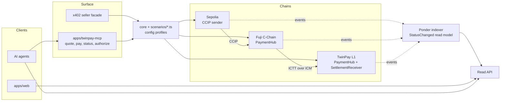

# Alternative architecture: protocol-centric, agent-native

**Verdict: documented, not built (Q3).** The chosen design is the hybrid in [Decisions › Q1](decisions.md#decision-log):
a `PaymentHub` protocol core on-chain, and one hexagonal package per demo off-chain. This page records the
alternative so the trade-off stays explicit.

## The idea

The hybrid already takes the protocol core on-chain. The alternative carries the same protocol-first idea through the
off-chain side too:

- **One protocol, many deployments.** A single Foundry project `protocol/` (`PaymentHub`, messenger plug-ins,
  `SettlementReceiver`) with the same bytecode on Fuji and TwinPay L1. Sepolia runs only a CCIP sender.
- **Demos are config profiles plus scripted scenarios** (`scenarios/*.ts`), not packages. Demo 3 is just another
  profile.
- **Agent-native surface.** An MCP server, `apps/twinpay-mcp`, exposes `quote`, `pay`, `status`, and `authorize` as
  tools. The x402 seller is a thin HTTP facade over the same core.
- **Event-sourced read model.** An indexer (Ponder) rebuilds payment state from `StatusChanged` events on Sepolia,
  Fuji, and the L1. The frontend and the agents read one API.

## Trade-offs

| Criterion | Chosen hybrid | Alternative |
|---|---|---|
| Off-chain code | One package per demo, composed through DI | Less code: scenarios and profiles only |
| Audit surface | One on-chain core | Same core, the same bytecode on every chain |
| Agent integration | Agents use ports inside our code | Any MCP-capable agent can pay through tools |
| Read model | Each demo reads chain state and events itself | One indexed API across all chains |
| Demo 3 | A composition root over Demos 1 and 2 | Free: another profile |
| Extra infrastructure | None beyond the L1 validator and relayer | Indexer database and an MCP server to host |
| Teachability on stage | High: one demo, one folder, step by step | Lower: the steps hide behind a generic protocol |
| Risk | Some repetition across demos | Over-generalizing one protocol in two weeks |

The alternative wins on less code, one audit surface across chains, an agent-native surface, a single read model,
and a free Demo 3. It loses on extra infrastructure, step-by-step teachability for the talk, and the risk of
over-generalizing.

## When to choose it

- The project outlives the hackathon.
- Third-party agents must integrate without our code.
