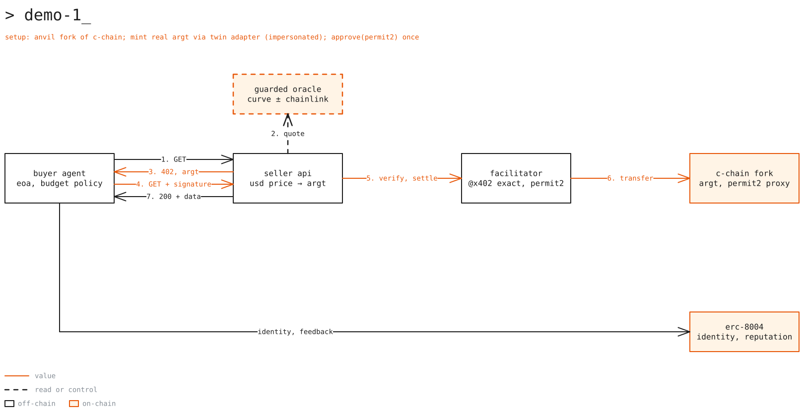
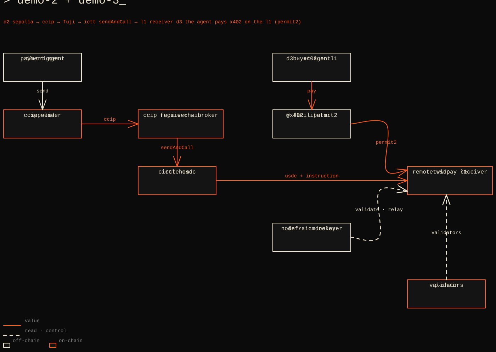

# Demos

Runbooks for the three talk demos. Why each choice was made: [Decisions](decisions.md). Commands marked
"(script added during implementation)" do not exist yet.

| Demo | Shows | Runs on | Mode |
|---|---|---|---|
| [1: x402 + Twin](#demo-1-x402--twin) | An agent pays an API in real ARGt over HTTP 402 | Local anvil fork of C-Chain mainnet | Live |
| [2: TwinPay L1](#demo-2-twinpay-l1) | A payment travels Sepolia → Fuji → TwinPay L1 | Sepolia, Fuji, TwinPay L1 | Live + recorded fallback |
| [3: Composed](#demo-3-composed) | The agent, funded via Demo 2, pays an API on the L1 | TwinPay L1 | Live + recorded fallback |

**Prerequisites:** Foundry (`anvil`, `cast`, `forge`), Node.js with pnpm, and Docker (Demos 2 and 3). Exact versions
are pinned during implementation.

## Demo 1: x402 + Twin

**What it shows.** An AI agent with an ERC-8004 identity buys an API response autonomously. The API is priced in
USD, quoted in ARGt from live market data, and paid in the real ARGt token over x402. No custom contract (Q4).



Edit: `docs/diagrams/demo-1.excalidraw`

**How it works**

- A local anvil fork of Avalanche C-Chain mainnet keeps chain ID 43114, so the real ARGt, Permit2, x402 proxy, and
  ERC-8004 contracts are all there. Nothing reaches mainnet (Q17, C1).
- The agent gets ARGt by calling the real `mint(address,uint256)` while the fork impersonates Twin's LayerZero
  adapter, which holds `MINTER_BURNER_ROLE`.
- The seller API answers `402` with an `exact` scheme quote: the ARGt amount from `GuardedOracle` (Curve, guarded by
  Chainlink), `assetTransferMethod: "permit2"`, and a `validUntil` about 30 s out (Q12/Q16).
- The agent checks its off-chain budget (`AgentPolicy`, Q5), signs a Permit2 transfer, and retries. The self-hosted
  facilitator verifies and settles through the x402 Permit2 proxy, and the API returns `200` (Q11).
- The agent posts feedback to the ERC-8004 Reputation Registry on the fork (function to be verified).

**Steps**

1. One-time setup
   - Create fresh encrypted keystores, never funded on mainnet (Q20). The fork keeps chain ID 43114, so a fork
     signature is also valid on mainnet:
     ```bash
     cast wallet import demo-agent --interactive
     cast wallet import demo-facilitator --interactive
     ```
   - Pick a recent fork block `N` and record it in the Demo 1 config profile.
2. Run
   - Start the fork:
     ```bash
     anvil --fork-url https://api.avax.network/ext/bc/C/rpc --fork-block-number <N> --chain-id 43114
     ```
   - Fund the fork: gas for the agent and the facilitator, ARGt minted to the agent, and the agent's one-time
     `approve(Permit2)` (script added during implementation).
   - Register the agent identity on the fork with `register(string agentURI)` (script added during implementation).
   - Start the facilitator and the seller API (scripts added during implementation).
3. On stage
   - `pnpm quote` (script added during implementation) prints the live rate, for example
     `1 USD = 1658.3 ARGt (Curve, block N) | Chainlink 1657.9 | Δ 0.02% ✓`.
   - Run the agent and narrate `402 → policy check → Permit2 signature → 200`.
   - Show the ARGt balances and the settlement transaction in the UI. The fork is local, so there is no public
     explorer link.
4. Fallback
   - No recorded fallback by decision (Q2); the demo only needs a local fork.
   - Start the fork before the talk and keep it running. If the public RPC fails at startup, try the backup RPC
     (unverified). If Curve drifts more than 2% from Chainlink, `GuardedOracle` uses Chainlink and the UI flags it.

## Demo 2: TwinPay L1

**What it shows.** The infrastructure side: a dedicated Avalanche L1 for agent payments, reached from Ethereum
through Chainlink CCIP and Avalanche ICM/ICTT (Q7).



Edit: `docs/diagrams/demo-2-3.excalidraw`

**How it works**

- A treasury on Fuji authorizes `PaymentBroker` to spend up to a budget through `PaymentHub` (EIP-712, Q5).
- The payment agent on Sepolia sends a data-only CCIP message to Fuji. `PaymentBroker` accepts it only from the
  allowlisted source chain and sender, then calls `PaymentHub.pay` on behalf of the treasury: `None → Pending`.
- `PaymentHub.dispatch` hands Circle testnet USDC to `IcttMessenger`, which calls ICTT `sendAndCall`: token plus
  payment instruction in one ICM message (Q14). The hub records `Pending → Dispatched`.
- The ICM relayer delivers to TwinPay L1. `SettlementReceiver.receiveTokens` checks the source blockchain ID and
  origin sender, pulls the tokens, and records `Received → Settled` (merchant credited) or `Rejected`.
- The L1 runs our own gas token, low fixed fees, and a Transaction AllowList: only registered agents transact (Q15).

**Steps**

1. One-time setup
   - Keystores for the deployer, the treasury, and the agent (`cast wallet import <name> --interactive`).
   - Testnet funds: Sepolia ETH and LINK (https://faucets.chain.link/), Fuji AVAX, and Circle testnet USDC on Fuji
     (faucet URLs to be verified).
   - Create TwinPay L1 with platform-cli and the genesis from Q15. Install:
     `curl -sSfL https://build.avax.network/install/platform-cli | sh`. Look up every subcommand with the Avalanche
     MCP (`cli_lookup_command`) or `platform-cli --help`; never guess.
   - Start the validator and the ICM relayer: `docker compose up -d` in `infra/` (compose file added during
     implementation; images and settings in [Decisions](decisions.md#avalanche-icm-and-the-l1)).
   - Deploy the ICTT bridge for Circle USDC (home on Fuji, remote on the L1), via
     https://build.avax.network/console/ictt/setup or scripts (to be decided).
   - Deploy `PaymentHub`, `IcttMessenger`, and `PaymentBroker` on Fuji and `SettlementReceiver` on the L1; set the
     allowlists (script added during implementation).
   - The treasury approves `PaymentHub` and signs the budget authorization (script added during implementation).
2. Run
   - Start the payment agent with the Demo 2 profile (script added during implementation).
3. On stage
   - Follow one payment hop by hop: the CCIP message in the CCIP Explorer (https://ccip.chain.link/), `Pending` and
     `Dispatched` on Fuji, then `Received` and `Settled` on the L1 explorer (URL to be verified).
   - Point at the `StatusChanged` events: one per transition, one event per hop.
4. Fallback
   - Replay a recorded run: pre-run transaction hashes and message IDs shown in the UI (Q2).

CCIP lane values (routers, selectors, LINK): [Decisions › CCIP](decisions.md#ccip-sepolia--fuji-active).

## Demo 3: Composed

**What it shows.** Demos 1 and 2 compose with no new domain logic: the same agent code pays an x402 API on
TwinPay L1, and a config profile switch moves it to Fuji C-Chain (Q13).

**How it works**

- Demo 2 funds the agent: its L1 address receives USDC through ICTT.
- Permit2 and the x402 Permit2 proxy sit at their canonical addresses on the L1, deployed through the deterministic
  deployer preallocated in genesis (Q15), so `@x402/evm` works unchanged.
- The self-hosted facilitator also registers the L1 chain. The seller API shows its USD price in ARGt via the same
  `GuardedOracle`, and settles in USDC until official ARGt exists on Fuji (Q17).
- Fallback profile: Fuji C-Chain with Circle USDC and the ERC-3009 transfer method. Same code, different profile.

**Steps**

1. One-time setup
   - Demo 2 infrastructure running (validator, relayer, ICTT bridge).
   - Deploy Permit2 (salt in [Decisions](decisions.md#avalanche-icm-and-the-l1), via `forge script`) and the x402
     proxy (coinbase/x402 `contracts/evm/script/Deploy.s.sol`) on the L1 (scripts added during implementation).
   - Fund the agent on the L1 through the Demo 2 path, give the facilitator L1 gas, and have the agent
     `approve(Permit2)` on the L1 USDC (scripts added during implementation).
2. Run
   - Start the facilitator, the seller API, and the agent with the L1 profile (scripts added during implementation).
3. On stage
   - Run the agent: `402 → pay → 200` on TwinPay L1.
   - Switch the profile to Fuji C-Chain live and run it again. That switch is the demo moment.
4. Fallback
   - Use the Fuji C-Chain profile, or replay a recorded run (Q2).

[probe](./nope.md)
