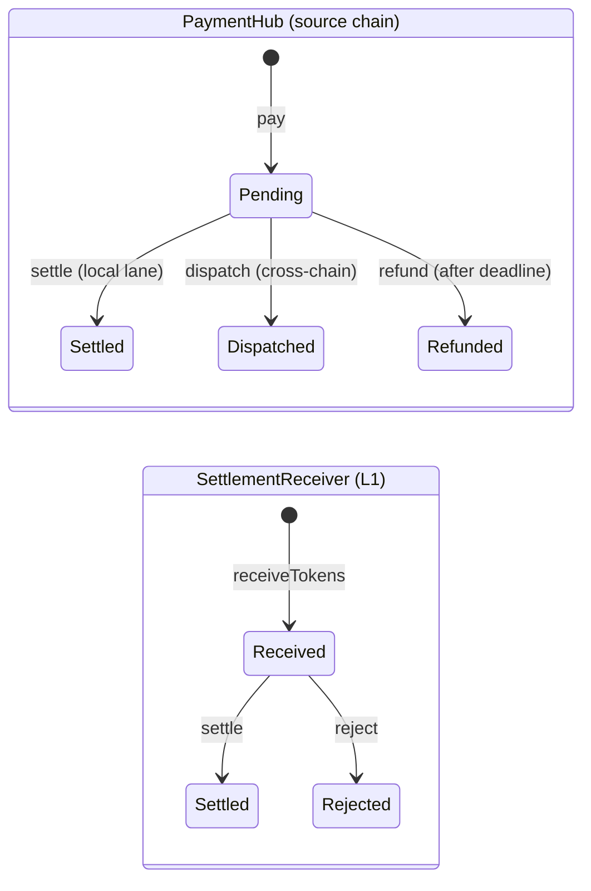

# Smart contract standards

How we design, write, test, and deploy the Solidity contracts. Decisions and verified addresses live in
[Decisions](../decisions.md); this page only applies them.

**Scope.** Demo 1 has no custom contract (Q4). Demos 2 and 3 use four contracts in one Foundry project:

| Contract | Chain | Role |
|---|---|---|
| `PaymentHub` | Fuji C-Chain (one singleton per chain) | Escrows a payment, then settles it locally or dispatches it cross-chain |
| `IcttMessenger` | Fuji C-Chain | Hub plug-in: sends token + instruction with ICTT `sendAndCall` |
| `PaymentBroker` | Fuji C-Chain | CCIP receiver: relays authorized payment instructions from Sepolia to the hub |
| `SettlementReceiver` | TwinPay L1 | ICTT receiver: settles or rejects each payment |

## 1. Design principles

Morpho Blue patterns, adapted. Morpho Blue is GPL-2.0-or-later; we copy patterns, never code (our repo is MIT).

- **Singleton per chain, immutable, no proxies.** `PaymentHub` holds every lane. The owner (OZ `Ownable2Step`) only
  enables plug-ins and never touches funds.
- **Isolated lanes by `Id`.** `type Id is bytes32`; `Id = LaneParamsLib.id(params)`, the `keccak256` of
  `LaneParams {token, merchant, messenger, destination}`. `messenger == address(0)` marks a local lane.
  `createLane` is permissionless but requires an enabled messenger.
- **Plug-ins by interface.** `IMessenger` adapters, enabled by the owner like Morpho's `enableIrm`. The demos need
  one: `IcttMessenger`. No on-chain oracle plug-in: pricing happens off-chain (`GuardedOracle`, Q12/Q16) and amounts
  reach the hub in token units.
- **EIP-712 authorization with a budget cap.** Like Morpho's `setAuthorizationWithSig`, extended with `budget` and
  `deadline`. An `authorized` address may call `pay` on behalf of the `authorizer` until the budget is spent. Built on
  OZ `EIP712` + `SignatureChecker` (ERC-1271, so smart accounts work) + `Nonces`. In Demo 2 the authorized address is
  `PaymentBroker`, which only accepts messages from the allowlisted Sepolia agent, so the budget caps what that
  agent can spend (Q5).
- **Callbacks.** Optional `IPaymentCallback.onPaymentSettled` on the merchant, so merchants compose (Demo 3).
  A failing callback must not strand funds; the policy is fixed with the receiver tests.
- **Safety defaults.** Pull over push, checks-effects-interactions, `SafeERC20`, and `ReentrancyGuardTransient`
  (needs `cancun`, which we target).
- **Deliberately skipped.** Shares math, `extSloads`, `ErrorsLib` string errors, on-chain oracles, upgradeability.

## 2. State pattern

One state machine per entity, one write path.



Image: [`state-machines.svg`](../diagrams/state-machines.svg). Edit: `docs/diagrams/state-machines.excalidraw`.

| Entity | Edges | Terminal |
|---|---|---|
| `PaymentHub` | `None → Pending` (`pay`), `Pending → Settled` (`settle`), `Pending → Dispatched` (`dispatch`), `Pending → Refunded` (`refund` after `deadline`) | `Settled`, `Dispatched`, `Refunded` |
| `SettlementReceiver` | `None → Received`, `Received → Settled`, `Received → Rejected` | `Settled`, `Rejected` |

There are no acknowledgements back to the source, so a dispatched payment can never be refunded: no double-spend
path.

**Rules**

- `None = 0`, so an unknown payment reads as `None`.
- Every change goes through `_transition(id, paymentId, from, to)`. It checks the stored state equals `from`,
  checks `PaymentStateLib.canTransition(from, to)` (a pure bitmask table), writes, and emits exactly one
  `StatusChanged(id, paymentId, from, to)`.
- Functions are named after transitions (`pay`, `settle`, `dispatch`, `refund`).
- Terminal states are absorbing. Expiry is an explicit, permissionless `refund` call; nothing changes state by time
  alone.
- `SettlementReceiver.receiveTokens` validates the sender pair before anything else (see
  [section 5](#5-lessons-from-ccip-icm)). A rejection is recorded, not reverted, so the outcome is visible on-chain.

```solidity
library PaymentStateLib {
  // Bit (from * 8 + to) is set when the edge from -> to is allowed.
  uint256 internal constant EDGES = (1 << (0 * 8 + 1)) // None -> Pending
    | (1 << (1 * 8 + 2)) // Pending -> Settled
    | (1 << (1 * 8 + 3)) // Pending -> Dispatched
    | (1 << (1 * 8 + 4)); // Pending -> Refunded

  function canTransition(IPaymentHub.Status _from, IPaymentHub.Status _to) internal pure returns (bool _allowed) {
    _allowed = (EDGES >> (uint256(_from) * 8 + uint256(_to))) & 1 == 1;
  }
}
```

**Tests**

- One Bulloak tree per transition; branches are the possible from-states.
- Handler-based invariants: terminal states are absorbing, only table edges occur, and tokens are conserved
  (escrowed = pending payments).
- The TypeScript side uses ABI-generated types. No hand-copied enums.

**Interface sketch** (Wonderland style; names may change during implementation):

```solidity
// SPDX-License-Identifier: MIT
pragma solidity 0.8.30;

type Id is bytes32;

interface IPaymentHub {
  /*///////////////////////////////////////////////////////////////
                              TYPES
  //////////////////////////////////////////////////////////////*/

  enum Status {
    None,
    Pending,
    Settled,
    Dispatched,
    Refunded
  }

  struct LaneParams {
    address token;
    address merchant;
    address messenger; // address(0) = local lane
    bytes32 destination; // destination chain identifier; 0 for local lanes
  }

  struct Authorization {
    address authorizer;
    address authorized;
    address token;
    uint256 budget;
    uint256 nonce;
    uint256 deadline;
  }

  /*///////////////////////////////////////////////////////////////
                              EVENTS
  //////////////////////////////////////////////////////////////*/

  event MessengerEnabled(address indexed _messenger);
  event LaneCreated(Id indexed _id, LaneParams _params);
  event AuthorizationSet(address indexed _authorizer, address indexed _authorized, address _token, uint256 _budget);
  event StatusChanged(Id indexed _id, bytes32 indexed _paymentId, Status _from, Status _to);

  /*///////////////////////////////////////////////////////////////
                              ERRORS
  //////////////////////////////////////////////////////////////*/

  error PaymentHub_InvalidTransition(Status _current, Status _to);
  error PaymentHub_MessengerNotEnabled(address _messenger);
  error PaymentHub_LaneNotFound(Id _id);
  error PaymentHub_Unauthorized(address _caller);
  error PaymentHub_BudgetExceeded(uint256 _remaining, uint256 _amount);
  error PaymentHub_InvalidSignature();
  error PaymentHub_SignatureExpired();
  error PaymentHub_DeadlineNotReached();
  error PaymentHub_ZeroAmount();

  /*///////////////////////////////////////////////////////////////
                              LOGIC
  //////////////////////////////////////////////////////////////*/

  function enableMessenger(address _messenger) external;
  function createLane(LaneParams calldata _params) external returns (Id _id);
  function setAuthorizationWithSig(Authorization calldata _authorization, bytes calldata _signature) external;
  function pay(Id _id, address _onBehalf, uint256 _amount, uint256 _deadline) external returns (bytes32 _paymentId);
  function settle(Id _id, bytes32 _paymentId) external;
  function dispatch(Id _id, bytes32 _paymentId) external;
  function refund(Id _id, bytes32 _paymentId) external;
  function statusOf(Id _id, bytes32 _paymentId) external view returns (Status _status);
}
```

## 3. Code standards

Wonderland boilerplate conventions (`dev` branch), with our gitflow (`feature/`) and repo-root hooks, commitlint,
and CI.

| Area | Rule |
|---|---|
| Compiler | Exact `pragma solidity 0.8.30;` and `evm_version = "cancun"` set explicitly (solc 0.8.30 defaults to `prague`; Avalanche has no Prague) |
| Format | `forge fmt`: line length 120, tab width 2, single quotes, sorted imports |
| Lint | `solhint-config-wonderland`; lintspec enforces NatSpec on every external item |
| Layout | Interface first: `src/interfaces/I<Contract>.sol` declares types, events, errors, and functions; the contract implements it |
| Errors | Custom errors named `Contract_Error`, declared in the interface. No require strings. |
| Naming | `_camel` for parameters and named returns; functions named after state transitions |
| Tests | Bulloak `.tree` files scaffold unit tests; contracts prefixed `Unit*` and `Integration*`; fuzz and handler-based invariant suites |
| Addresses | Constructor-injected (router, LINK, ICTT transferrer, Teleporter, registries). No hardcoded addresses in `src/`. |
| Deploy | `forge script` with encrypted keystores: `--account <keystore-name>`, never raw keys. Scripts map `block.chainid` to parameters from the shared chain registry. Verify on the explorer. |

```toml
# foundry.toml (excerpt; align with the boilerplate's dev branch)
[profile.default]
solc_version = '0.8.30'
evm_version = 'cancun'

[fmt]
line_length = 120
tab_width = 2
quote_style = 'single'
sort_imports = true
```

```bash
forge script script/Deploy.s.sol --rpc-url <rpc-url> --account <keystore-name> --broadcast
```

## 4. Dependencies

pnpm only, exact pins, no git submodules. CCIP and Chainlink Local import older OpenZeppelin versions, so those
versions coexist through pnpm aliases and versioned remappings.

```json
{
  "dependencies": {
    "@openzeppelin/contracts": "5.7.0",
    "@openzeppelin/contracts-5.3.0": "npm:@openzeppelin/contracts@5.3.0",
    "@openzeppelin/contracts-4.8.3": "npm:@openzeppelin/contracts@4.8.3",
    "@chainlink/contracts-ccip": "2.0.0",
    "@chainlink/contracts": "1.5.0",
    "@chainlink/local": "0.3.1"
  }
}
```

```text
@openzeppelin/contracts/=node_modules/@openzeppelin/contracts/
@openzeppelin/contracts@5.3.0/=node_modules/@openzeppelin/contracts-5.3.0/
@openzeppelin/contracts@4.8.3/=node_modules/@openzeppelin/contracts-4.8.3/
@chainlink/contracts-ccip/=node_modules/@chainlink/contracts-ccip/
@chainlink/contracts/=node_modules/@chainlink/contracts/
@chainlink/local/=node_modules/@chainlink/local/
```

- `forge-std` comes through pnpm as well (version to be verified against the boilerplate).
- Verify every remapping against the installed packages before the first build.
- ICM/ICTT has no npm package. Vendor only the interfaces we call (`IERC20SendAndCallReceiver`, the ICTT
  `sendAndCall` entry point, and `SendAndCallInput`) from `ava-labs/icm-services` into
  `src/interfaces/external/icm/`, pinned to a commit. Check the license first (to be verified).

## 5. Lessons from ccip-icm

`smartcontractkit/ccip-icm` gives us the flow (Sepolia → Fuji → L1), not its code standards. Fix each gap:

| Gap in ccip-icm | Our rule |
|---|---|
| No source checks | Allowlist the source chain selector **and** sender as a pair (CCIP), and the source blockchain ID **and** origin sender as a pair (ICTT/ICM). |
| Public `brokerMessage` | The broker acts only inside `_ccipReceive`, which `CCIPReceiver` restricts to the router. |
| A single `latestMessageText` | Queue-safe: every message is keyed by its ID; nothing is overwritten. |
| Hardcoded Teleporter and blockchain IDs | Constructor-injected addresses and IDs. |
| `allowOutOfOrderExecution` extraArgs | CCIP 2.0: `ExtraArgsCodec._getBasicEncodedExtraArgsV3(gasLimit, bytes4(0))` (full finality). Fees in native (`feeToken = address(0)`) or LINK. |
| Silent hops | One event per hop, so the UI and the agent can track a payment end to end. |

Also from `chainlink-ccip-skill`: the CCIP message is data-only (the token moves on Fuji via ICTT), router and LINK
are constructor arguments, and the receiver keeps the default full-finality config.

## 6. Agent tooling

| Tool | Use it for |
|---|---|
| OpenZeppelin MCP (`.mcp.json`) | Scaffold OZ 5.7 bases and confirm OZ APIs. It has no ERC-3009 option. |
| `chainlink-ccip-skill` | `PaymentBroker` (CCIP receiver) patterns and `CCIPLocalSimulator` tests |
| `chainlink-data-feeds-skill` | `ChainlinkFeedOracle`: runtime `decimals()`, staleness against the 24 h heartbeat, and the Base sequencer-uptime check (feed address to be verified) |
| Avalanche MCP + local `avalanche` skill | ICM/ICTT, L1 genesis, platform-cli lookups |
| ethskills `security`, `testing`, `audit` | Before every Fuji or L1 deploy |
